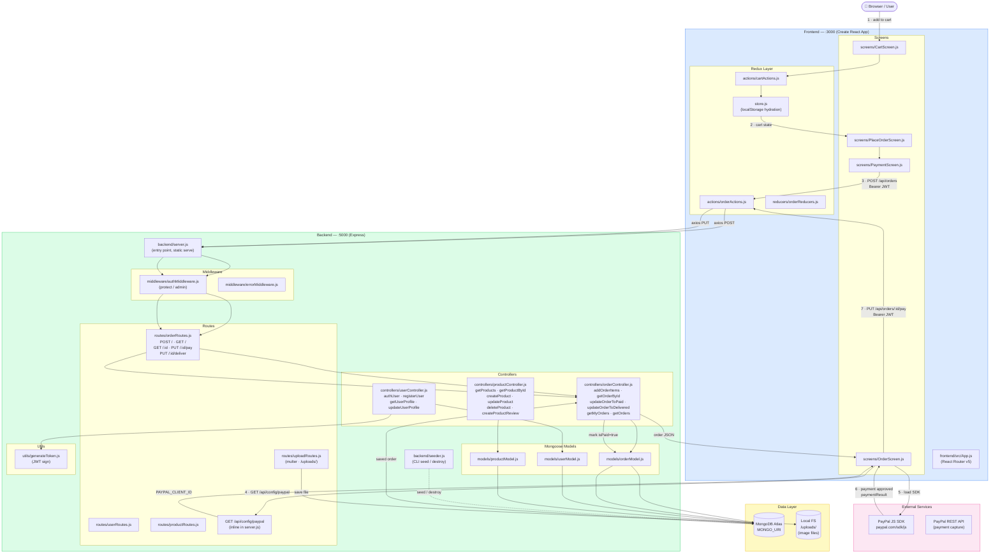

# Architecture — C4 Container Diagram

Use-case: **Place & Pay for Order**

## Flow steps

| # | Step |
|---|------|
| 1 | User adds items to cart — `cartActions` persists to `localStorage` via Redux |
| 2 | `PlaceOrderScreen` reads cart state from Redux store |
| 3 | `POST /api/orders` with `Bearer JWT` — order saved to MongoDB |
| 4 | `OrderScreen` fetches `PAYPAL_CLIENT_ID` from `/api/config/paypal` |
| 5 | Browser loads PayPal JS SDK dynamically |
| 6 | After user approves payment, PayPal returns `paymentResult` |
| 7 | `PUT /api/orders/:id/pay` — sets `isPaid=true` and `paidAt` in MongoDB |

> Dashed line — `backend/seeder.js` is a CLI tool, not an HTTP path.
