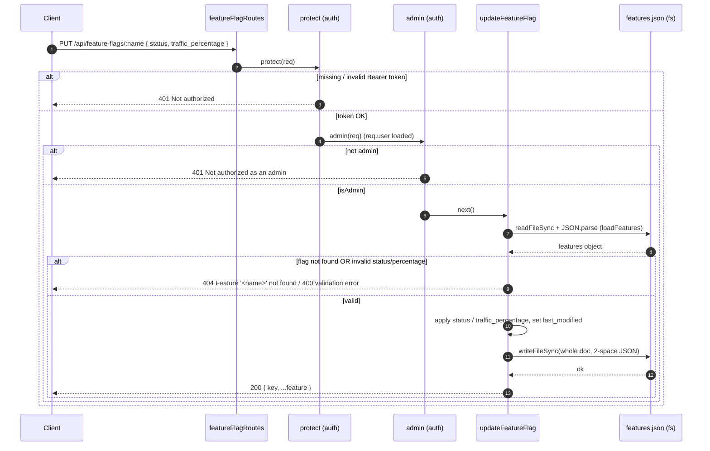

# Overview

`backend/controllers/featureFlagController.js` is a thin file-backed controller that
exposes the contents of `backend/features.json` over HTTP. It imports `readFileSync`
and `writeFileSync` from `fs` and resolves the data file relative to the process
working directory: `FEATURES_PATH = path.join(__dirname, 'backend', 'features.json')`
where `__dirname = path.resolve()` (i.e. `process.cwd()`, NOT the module directory).

**Endpoints** (wired in `backend/routes/featureFlagRoutes.js`):

- `GET /api/feature-flags` → `getFeatureFlags` — **Public**. Calls `loadFeatures()`
  and returns the whole object verbatim.
- `GET /api/feature-flags/:name` → `getFeatureFlagByName` — **Public**. Looks up
  `features[req.params.name]`; 404 with message `Feature '<name>' not found` if
  missing (raw `req.params.name` reflected into the error string); otherwise returns
  `{ key, ...feature }`.
- `PUT /api/feature-flags/:name` → `updateFeatureFlag` — **Private/Admin** (guarded
  by `protect` then `admin` from `authMiddleware.js`). Loads the file, fetches the
  flag (404 if missing), then conditionally applies two fields from `req.body`.

**Validation rules (PUT):** `status`, if present, must be one of
`['Enabled','Testing','Disabled']` (400 otherwise). `traffic_percentage`, if present,
is coerced via `Number()` and must be `0–100` and not `NaN` (400 otherwise). Both
fields are optional and independently applied. No body schema/validation tier; unknown
body keys are ignored. After updates, `feature.last_modified` is set to today's date
(`new Date().toISOString().split('T')[0]`, UTC `YYYY-MM-DD`), the flag is written back
into the object, and the **entire file is rewritten** with `JSON.stringify(features, null, 2)`.

**File read/write pattern:** every request re-reads and re-parses the file from disk
(`readFileSync` on the hot path — no caching). PUT is a non-atomic read-modify-write
of the whole document.

**Auth:** only PUT is protected (`protect` requires a valid `Bearer` JWT and loads
`req.user`; `admin` requires `req.user.isAdmin`). Both GETs are fully public.

**Invariants / assumptions:** `features.json` exists, is readable, and is valid JSON
of shape `Record<key, { name, description, status, traffic_percentage, last_modified,
targeted_segments, rollout_strategy, dependencies? }>`. The MCP server
`mcp-server-feature-flags/src/index.ts` is a **second independent writer** of the same
file (resolved to the same path), with a **divergent contract**: it accepts a fourth
status `Shadow`, enforces dependency gating on enable, zeroes traffic on Disable, and
locks traffic>0 while Disabled — none of which this controller knows about.

## Decision Table

| # | Condition | Then-action | Else-action | Edge case |
|---|-----------|-------------|-------------|-----------|
| 1 | `GET /` requested | Read+parse file, return full object 200 | — | File missing/corrupt → unhandled throw → 500 |
| 2 | `GET /:name`, flag exists | Return `{ key, ...feature }` 200 | Set 404, throw `Feature '<name>' not found` | `name` reflected unescaped into message |
| 3 | `GET /:name`, flag absent | Set 404, throw not-found | Return flag | `__proto__`/`constructor` may resolve a truthy inherited member |
| 4 | `PUT /:name` without valid JWT | `protect` sets 401 `Not authorized, no token`/`token failed` | Proceed to `admin` | Expired/invalid token → 401 in catch |
| 5 | `PUT /:name`, JWT valid but `!isAdmin` | `admin` sets 401 `Not authorized as an admin` | Proceed to controller | `req.user` null (deleted user) → 401 |
| 6 | `PUT /:name`, flag absent | Set 404, throw not-found (no write) | Continue | Same `name` reflection as #2 |
| 7 | `PUT` body `status` present & valid | Assign `feature.status` | If invalid → 400 `Status must be Enabled, Testing, or Disabled` | `Shadow` valid in MCP but **rejected** here |
| 8 | `PUT` body `status` is `undefined`/omitted | Leave status unchanged | Validate/apply | `status: null` is `!== undefined` → fails enum → 400 |
| 9 | `PUT` body `traffic_percentage` present, numeric 0–100 | Assign coerced `pct` | If `NaN`/`<0`/`>100` → 400 | `"50"` string coerces OK; `""` → 0 (passes!); `"  "` → 0 |
| 10 | `PUT` body `traffic_percentage` omitted | Leave traffic unchanged | Validate/apply | `null` → `Number(null)=0` passes silently |
| 11 | `PUT` with neither field | Still bump `last_modified` + rewrite file | — | No-op write churns file + races MCP |
| 12 | After validation passes | Set `last_modified` to UTC date, `writeFileSync` whole doc | — | Write fails (perms/disk) → throw mid-op, possible truncation |
| 13 | Concurrent PUT (backend) + MCP tool call | Both read-modify-write, last writer wins | — | Lost update; no lock/transaction |
| 14 | PUT enables a flag whose dependency is Disabled | Succeeds (no dependency check) | — | MCP would reject; contracts diverge |
| 15 | PUT sets `traffic_percentage` while `status: Disabled` | Succeeds (no cross-field lock) | — | MCP enforces traffic=0 when Disabled |

## Sequence Diagram

## Edge Cases

- **Concurrent write with the MCP server:** backend PUT and an MCP `set_feature_state`/
  `adjust_traffic_rollout` both do read-modify-write on the same file with no locking →
  lost update (last writer wins), and MCP appends a trailing `\n` while the backend does
  not, causing spurious file diffs.
- **Malformed `features.json`:** `JSON.parse` throws a `SyntaxError` inside the async
  handler; it is not caught locally → bubbles to Express error handler as a 500 with no
  flag-specific context. Every endpoint is affected because the parse is per-request.
- **Missing `features.json`:** `readFileSync` throws `ENOENT`. Because the path is
  `cwd()/backend/features.json`, running the process from any directory other than the
  repo root silently breaks all three endpoints.
- **Invalid `status` value:** any non-empty value outside the enum → 400; but `Shadow`
  (a legitimate MCP state) is rejected here, so a flag set to `Shadow` by the MCP cannot
  be re-saved unchanged via this controller without first changing status.
- **Unknown flag name:** 404 with the raw name interpolated into the message.
- **Prototype-pollution / inherited-key access via `req.params.name`:** `features[req.params.name]`
  is a direct bracket lookup on a plain object. Keys like `__proto__`, `constructor`,
  `toString`, `hasOwnProperty` resolve to inherited members (truthy) instead of 404, so
  GET/PUT may treat them as existing "flags"; PUT then assigns `.status`/`.traffic_percentage`
  onto that object and writes it back, risking a polluted/garbage entry in the JSON.
- **Reflected input (XSS/log-injection vector):** `req.params.name` is echoed unescaped
  in error messages; if surfaced in an HTML context downstream it is an injection surface.
- **Partial / failed write:** `writeFileSync` is not atomic (no temp-file + rename). A
  crash, full disk, or permission error mid-write can leave a truncated/corrupt
  `features.json`, which then breaks every subsequent read (cascading from edge case 2).
- **Empty-string / null traffic coercion:** `Number('')`, `Number(null)`, `Number([])`
  all yield `0`, which passes the `0–100` check — so `traffic_percentage: ""` silently
  sets traffic to 0 instead of being rejected. `Number(undefined)` is `NaN` but the
  `=== undefined` guard skips it.
- **Missing cross-field invariants:** controller can enable a flag whose dependency is
  Disabled, or set traffic>0 on a Disabled flag — both forbidden by MCP — producing
  inconsistent state depending on which writer last touched the flag.
- **No-op PUT still mutates:** a PUT with an empty/irrelevant body still rewrites
  `last_modified` and the whole file, bumping the date and creating write contention.
- **Date semantics:** `last_modified` uses UTC date only; near midnight or for non-UTC
  operators the recorded date can differ from local "today", and time-of-day is lost.
- **Missing auth on reads:** both GET endpoints are public, exposing full flag metadata
  (descriptions, segments, rollout strategy, dependencies) to anonymous clients.
- **Hot-path `readFileSync`:** synchronous disk read on every request blocks the event
  loop; under load this serializes request handling (PERF-003/004).

## Open Questions

- Should `features.json` be cached in memory (with invalidation) instead of re-reading
  per request, given the dual-writer reality makes a cache hard to keep coherent?
- Should the backend and MCP share a single validation contract (status enum incl.
  `Shadow`, dependency gating, traffic/Disabled lock, trailing newline)? Today they diverge.
- What is the source of truth for concurrent writes — should both writers go through a
  lock, a single owning service, or move off the flat file entirely (proposed ADR-0005)?
- Should reads require auth (or at least hide internal fields like `description`/`targeted_segments`)?
- Is `__dirname = path.resolve()` (cwd-relative) intentional, or should it be module-relative
  to survive being launched from a different directory?
- Should `req.params.name` be validated against an allow-list / `Object.hasOwn` to close
  the prototype-key lookup hole and the reflected-input issue?

## Suggested Characterization Tests

1. `GET /api/feature-flags` returns 200 and an object whose keys match the current
   `features.json` (e.g. contains `search_v2`, `dark_mode`).
2. `GET /api/feature-flags/dark_mode` returns 200 `{ key: 'dark_mode', name, status, ... }`.
3. `GET /api/feature-flags/nope` returns 404 with body message `Feature 'nope' not found`.
4. `GET /api/feature-flags/__proto__` — pin current behavior (does it 404 or return a
   truthy inherited member?) to detect change when the lookup is hardened.
5. `PUT /api/feature-flags/dark_mode` with no/expired token → 401 (`protect`).
6. `PUT` with a valid non-admin token → 401 `Not authorized as an admin`.
7. `PUT` (admin) `{ status: 'Enabled' }` → 200, response status is `Enabled`,
   `last_modified` equals today's UTC date, and file content is updated.
8. `PUT` (admin) `{ status: 'Shadow' }` → 400 `Status must be Enabled, Testing, or Disabled`
   (pins the divergence from MCP).
9. `PUT` (admin) `{ traffic_percentage: 150 }` → 400; `{ traffic_percentage: -1 }` → 400.
10. `PUT` (admin) `{ traffic_percentage: '50' }` → 200 with numeric `50` (string coercion).
11. `PUT` (admin) `{ traffic_percentage: '' }` → pins current behavior (currently coerces
    to `0` and succeeds) so a future stricter validator is detected.
12. `PUT` (admin) on unknown flag → 404 and the file is **unchanged** (no write side effect).
13. `PUT` (admin) `{}` empty body → 200 but `last_modified` is bumped and file rewritten
    (pins the no-op-still-writes behavior).
14. `PUT` (admin) enabling a flag whose dependency is `Disabled` → succeeds (pins lack of
    dependency gating vs MCP).
