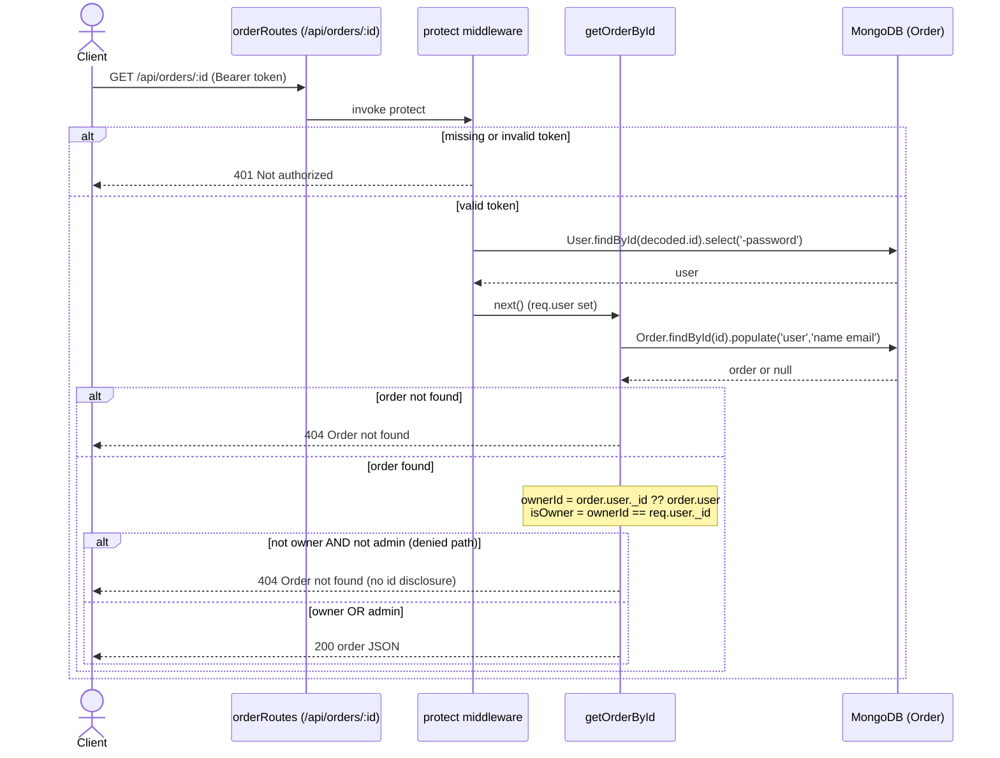

# Overview

`backend/controllers/orderController.js` is the Express/Mongoose controller for the
order lifecycle in the ProShop MERN store. It is mounted under `/api/orders`
(`backend/routes/orderRoutes.js`) and exposes six handlers. Every route is wrapped
in `protect` (JWT auth via `backend/middleware/authMiddleware.js`), which decodes the
`Bearer` token, loads the user (minus password) onto `req.user`, and returns `401`
when the token is missing or invalid. The `admin` middleware additionally gates
admin-only routes, returning `401` when `req.user.isAdmin` is falsy.

Endpoints and per-route auth:

- **`addOrderItems`** — `POST /api/orders`, `protect`. Creates an order from the
  request body, stamping `user: req.user._id`. Returns `201` with the saved order.
- **`getOrderById`** — `GET /api/orders/:id`, `protect`. Loads the order and
  populates `user` (name, email). **Owner/admin guard (Stage-2 fix, today):** a
  non-owner who is not admin now receives `404 Order not found` — identical to a
  missing order so the id's existence is not disclosed (closes the prior IDOR).
- **`updateOrderToPaid`** — `PUT /api/orders/:id/pay`, `protect`. Sets `isPaid`,
  `paidAt`, and `paymentResult` from the request body. No ownership check, no
  server-side PayPal verification (still open).
- **`updateOrderToDelivered`** — `PUT /api/orders/:id/deliver`, `protect, admin`.
  Sets `isDelivered`/`deliveredAt`.
- **`getMyOrders`** — `GET /api/orders/myorders`, `protect`. Returns orders where
  `user === req.user._id`.
- **`getOrders`** — `GET /api/orders`, `protect, admin`. Returns all orders
  (unbounded; populates `user` id/name).

**Client-trusted pricing assumption:** `itemsPrice`, `taxPrice`, `shippingPrice`,
and `totalPrice` are computed in `frontend/src/screens/PlaceOrderScreen.jsx:23-28`
(items reduce, free shipping over $100, 15% tax) and sent verbatim. The server
stores them without recomputing from authoritative product prices (ADR-0004
candidate).

**Invariants:** an order always has a `user` owner; price fields default to `0.0`;
`isPaid`/`isDelivered` default `false`; the model requires a non-empty
`shippingAddress` and `paymentMethod`.

## Decision Table

| # | Condition | Then-action | Else-action | Edge case |
|---|---|---|---|---|
| 1 | Request lacks valid `Bearer` token (any route) | `protect` throws `401 Not authorized` | Continue to handler | Expired/forged JWT also yields 401 (token failed) |
| 2 | `POST /orders` with `orderItems.length === 0` | `400 No order items` | Build & save order | `orderItems` missing/undefined skips the guard (`&&`) and hits Mongoose `required` validation |
| 3 | `POST /orders` valid body | Save order, `201` with order | — | Client-supplied totals stored verbatim, not recomputed |
| 4 | `GET /orders/:id`, order not found | `404 Order not found` | Evaluate ownership | Malformed ObjectId → CastError surfaced by error handler |
| 5 | `GET /orders/:id`, requester is owner | `200` with populated order | Check admin | `order.user` may be populated object or raw id; both normalized via `_id ?? user` |
| 6 | `GET /orders/:id`, not owner but `isAdmin` | `200` with populated order | Deny | Admin can read any order |
| 7 | `GET /orders/:id`, not owner and not admin | `404 Order not found` (NEW guard) | — | Same 404 as missing → no id-existence disclosure |
| 8 | `PUT /orders/:id/pay`, order found | Set `isPaid/paidAt/paymentResult`, save, `200` | `404 Order not found` | No ownership check — any authed user can pay any order (open) |
| 9 | `PUT /orders/:id/pay`, `req.body.payer` absent | `email_address` set to `undefined` | Set from `payer.email_address` | Optional-chain guard prevents crash on missing payer |
| 10 | `PUT /orders/:id/pay`, attacker-supplied `paymentResult` | Stored as-is, order marked paid | — | No server-side PayPal capture verification (open) |
| 11 | `PUT /orders/:id/deliver`, requester not admin | `admin` throws `401` | Mark delivered, `200` | Route-level admin gate before handler runs |
| 12 | `PUT /orders/:id/deliver`, order not found | `404 Order not found` | Mark delivered | — |
| 13 | `GET /orders/myorders` | Return only `{ user: req.user._id }` orders | — | Returns `[]` when user has no orders (200, not 404) |
| 14 | `GET /orders` requester not admin | `admin` throws `401` | Return all orders | — |
| 15 | `GET /orders` requester admin | `200` with all orders (unbounded) | — | Multi-MB payload risk as collection grows (no pagination) |

## Sequence Diagram

## Edge Cases

- **Non-owner access (now blocked):** authenticated user requesting another user's
  order id receives `404 Order not found` — the Stage-2 guard closes the prior IDOR
  enumeration of PII/address/email/payment data.
- **Admin access:** an admin (`isAdmin === true`) bypasses the owner check and reads
  any order via `getOrderById` and the full list via `getOrders`.
- **Missing order:** `getOrderById`, `updateOrderToPaid`, `updateOrderToDelivered`
  all return `404 Order not found` when `findById` resolves null.
- **Unauthenticated request:** any route without a valid `Bearer` token is rejected
  by `protect` with `401` before the controller runs.
- **Mark-paid by non-owner (still open):** `updateOrderToPaid` has no ownership or
  admin check — any authenticated user can mark any order paid (privilege/integrity
  gap, ADR-0002 trust gap).
- **Malicious `paymentResult` (still open):** payment id/status/update_time/email are
  copied verbatim from the request body with no server-side PayPal capture
  verification; a forged payload marks an order paid.
- **Missing `req.body.payer`:** `email_address` falls back to `undefined` via optional
  chaining rather than throwing.
- **Client-supplied inflated total:** server stores an oversized `totalPrice` as-is;
  no recomputation from product prices (ADR-0004 candidate).
- **Client-supplied zero total:** `totalPrice: 0` is accepted (model default is `0.0`,
  not a positive minimum) — an order can be created and paid for $0.
- **Empty `orderItems` array:** `[]` returns `400 No order items`.
- **Missing/undefined `orderItems`:** the `orderItems && length===0` guard is skipped,
  so it falls through to Mongoose `required` validation (500/validation error) rather
  than the intended `400`.
- **Concurrent pay:** two simultaneous `PUT /pay` on the same order both read, both
  write; last-write-wins on `paidAt`/`paymentResult` with no idempotency or version
  guard.
- **Malformed ObjectId in `:id`:** Mongoose CastError propagates to the global error
  handler (typically `500`/cast error), not a clean `404`.
- **`order.user` populated vs raw:** ownership compares `order.user._id ?? order.user`
  so the guard works whether or not `populate` ran — both branches stringified before
  comparison.
- **`getMyOrders` with no orders:** returns `200` with `[]`, never `404`.
- **`getOrders` unbounded:** admin list returns every order with no pagination —
  latency and payload grow linearly with collection size (perf HIGH).
- **`addOrderItems` always uses `req.user._id` as owner:** a client cannot spoof the
  order owner via the body; `user` is server-stamped.
- **Tax/shipping rules are client-side only:** the $100 free-shipping threshold and
  15% tax live in `PlaceOrderScreen.jsx`; the server enforces none of them.

## Open Questions

- **`updateOrderToPaid` ownership + verification (OPEN):** should it require
  owner/admin, and perform server-side PayPal capture verification before marking
  paid? (Stage-1 HIGH #3; compounds ADR-0002.)
- **Server-authoritative pricing (ADR-0004 candidate, OPEN):** should the server
  recompute `itemsPrice/taxPrice/shippingPrice/totalPrice` from authoritative product
  prices at order creation instead of trusting `PlaceOrderScreen.jsx`? (Stage-1 #10.)
- **Zero/negative totals:** should the model enforce a positive `totalPrice` minimum?
- **Idempotency on `/pay`:** should a paid order reject a second pay attempt instead of
  last-write-wins?
- **`getOrders` pagination:** unbounded admin list — add pagination + indexed
  `createdAt` sort? (Stage-1 perf HIGH #9.)
- **404-vs-403 on denied read:** the guard deliberately returns `404` (anti-enumeration)
  rather than `403`; confirm this is the desired contract.
- **CastError handling:** should malformed `:id` map to a clean `404` rather than a cast
  error?

## Suggested Characterization Tests

1. **Owner reads own order →** `GET /api/orders/:id` as owner returns `200` with the
   populated order.
2. **Non-owner blocked (pins Stage-2 fix) →** non-owner non-admin gets `404 Order not
   found`, body identical to the missing-order case.
3. **Admin reads any order →** admin (`isAdmin`) gets `200` for another user's order.
4. **Missing order →** unknown id returns `404 Order not found`.
5. **Unauthenticated →** no token returns `401`; bad/expired token returns `401`.
6. **Create order success →** valid body returns `201` and stamps `user: req.user._id`
   (ignoring any body-supplied owner).
7. **Empty orderItems →** `[]` returns `400 No order items`.
8. **Client-trusted totals stored verbatim (pins ADR-0004 gap) →** inflated and zero
   `totalPrice` are persisted unchanged.
9. **Mark-paid by non-owner (pins OPEN gap) →** non-owner `PUT /pay` currently
   succeeds (`200`, `isPaid===true`); test documents current behavior.
10. **Forged paymentResult (pins OPEN gap) →** arbitrary body id/status persisted with
    no verification.
11. **Pay missing `payer` →** `email_address` stored as `undefined`, no crash.
12. **Deliver requires admin →** non-admin `PUT /deliver` returns `401`; admin returns
    `200` with `isDelivered===true`.
13. **getMyOrders scoping →** returns only the caller's orders; `[]` (200) when none.
14. **getOrders requires admin →** non-admin `401`; admin `200` with all orders.
