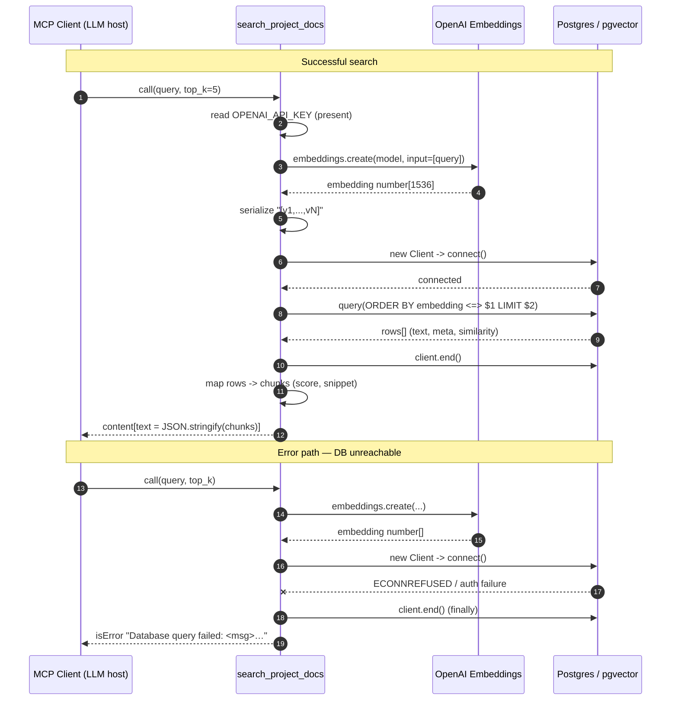

# Overview

**Module:** `mcp-server-search-docs/src/index.ts`
**Type:** Node/TypeScript Model Context Protocol (MCP) server (stdio transport), a Retrieval-Augmented Generation (RAG) retrieval layer over the ProShop MERN documentation corpus.

## What it exposes

One MCP **tool** and one MCP **resource**:

- **Tool `search_project_docs`** — semantic search over the project documentation corpus (47 markdown docs / 723 indexed chunks: architecture, ADRs, runbooks, incidents, glossary, dev history, API specs, page descriptions).
  - **Input:** `query` (string, natural-language, required) and `top_k` (integer, `1..20`, default `5`, enforced by a Zod schema).
  - **Output:** a single text content item whose text is a pretty-printed JSON array of chunk objects, each with `source_file`, `file_path`, `title`, `parent_headings` (breadcrumb array), `score` (cosine similarity rounded to 4 dp), and `snippet` (first ~200 chars of the chunk text, `"..."`-truncated).
- **Resource `status` (`server://status`)** — returns JSON `{ status: "ok", uptime }`.

## Flow: query → embedding → vector search → results

1. Tool handler reads `OPENAI_API_KEY` from env at call time; if absent it returns `isError` with a remediation message.
2. Constructs a fresh `OpenAI` client and calls `embedText`, which requests one embedding from model `text-embedding-3-small` (`embeddings.create({ input: [query] })`) and returns `response.data[0].embedding` (a `number[]`).
3. Serializes the vector to a pgvector literal string `"[v1,v2,...]"`.
4. Opens a **fresh `pg.Client`** per call (no pool), connects, runs a parameterized query that orders `chunks` by `embedding <=> $1::vector` (cosine distance) and returns `1 - distance` as `similarity`, `LIMIT $2`. Always `client.end()` in `finally`.
5. Maps rows into the output shape and returns them as JSON text.

## Data assumptions / schema

A table `chunks(text, source_file, file_path, title, parent_headings text[], embedding vector)` populated out-of-band by `scripts/embed_chunks.js`. The `embedding` column dimensionality must match `text-embedding-3-small` (1536). pgvector extension and the `<=>` cosine operator must be available.

## Invariants

- `top_k` is bounded to `1..20` by Zod before the handler runs.
- SQL is parameterized (no SQL injection on `query`/vector).
- DB client is always closed (`finally`).

## Config / env

`OPENAI_API_KEY` (required, read per call). DB via `POSTGRES_HOST/PORT/DB/USER/PASSWORD` — **all default to `localhost/5432/proshop/proshop/proshop` (hardcoded fallback creds)**. `.env` is loaded from the repo root (two levels up from the compiled file).

---

## Decision Table

| # | Condition | Then-action | Else-action | Edge case |
|---|-----------|-------------|-------------|-----------|
| 1 | `OPENAI_API_KEY` unset/empty | Return `isError` with "OPENAI_API_KEY is not set…" message | Construct OpenAI client and continue | Whitespace-only key passes the truthy check, then fails at OpenAI call (row 4) |
| 2 | `query` is not a string | Zod rejects before handler runs (tool input validation error) | Handler executes with valid `query` | Empty string `""` passes Zod (no `.min`) and is embedded |
| 3 | `top_k` outside `1..20` or non-integer | Zod rejects the call | Use provided value | `top_k` omitted → defaults to `5` |
| 4 | `embedText` throws (API/network/auth/timeout) | Return `isError` "Failed to generate embedding: <msg>" | Proceed with embedding vector | OpenAI returns 200 but `data` empty → `data[0]!` non-null assertion throws TypeError, caught here |
| 5 | Embedding array returned by OpenAI | Join into `"[...]"` pgvector literal | n/a | Empty embedding → `"[]"`, sent to DB (row 8) |
| 6 | `client.connect()` throws (DB down / wrong creds / host unreachable) | Caught → return `isError` "Database query failed: <msg>…" | Proceed to query | `finally` still calls `client.end()` on a never-connected client |
| 7 | `client.query()` throws (bad SQL / missing `chunks` table / pgvector op absent / dim mismatch) | Caught → return `isError` "Database query failed…" | Assign `result.rows` | Dimension mismatch surfaces as a pg error string here |
| 8 | Query runs but returns 0 rows | `rows = []` → `chunks = []` → returns `"[]"` JSON | Map rows to chunks | No "no results" signal distinct from success |
| 9 | `row.parent_headings` is null/undefined | Default to `[]` (`|| []`) | Use array as-is | DB column stores `null` instead of `'{}'` |
| 10 | `row.similarity` non-numeric / null | `parseFloat(String(...))` → `NaN`, `toFixed(4)` → `"NaN"`, `parseFloat` → `NaN` in `score` | Numeric rounded score | `NaN` serialized by `JSON.stringify` as `null` |
| 11 | `row.text.length > 200` | `slice(0,200) + "..."` snippet | Use full `row.text` as snippet | `row.text` is null/undefined → `.length` throws TypeError (uncaught, after the try/finally) |
| 12 | `row.text` contains adversarial instructions | Returned verbatim in `snippet` to the calling LLM | n/a | **Prompt-injection surface** — retrieved text is untrusted |
| 13 | Tool invoked with extra/unknown input keys | Zod strips/ignores unknown keys; handler runs | n/a | Depends on MCP SDK schema strictness |
| 14 | Concurrent tool calls | Each opens its own `pg.Client` + OpenAI client | n/a | **No pool** → connection churn / exhaustion under load |
| 15 | Same `query` issued repeatedly | Re-embedded every time (fresh OpenAI call) | n/a | **No cache** → latency + token spend |

---

## Sequence Diagram

---

## Edge Cases

- **Empty query (`""`):** passes Zod (no `.min(1)`), gets embedded and searched — wastes an OpenAI call and returns low-signal/arbitrary nearest neighbors.
- **Oversized query:** very long `query` may exceed the embedding model's token limit → OpenAI 400, caught as "Failed to generate embedding".
- **Whitespace-only API key:** truthy check (row 1) passes, so error surfaces later as an OpenAI auth failure with a less clear message.
- **OpenAI auth failure (invalid/revoked key):** `embedText` throws → `isError` embedding message.
- **OpenAI rate limit / 429:** thrown and surfaced as embedding failure; no retry/backoff.
- **OpenAI timeout / network drop:** no explicit timeout configured (SDK default); slow calls block the per-call handler with no cancellation.
- **OpenAI returns empty `data`:** `response.data[0]!` non-null assertion produces a runtime TypeError, caught by the embedding try/catch.
- **Empty embedding vector:** serializes to `"[]"` and is sent to pgvector → likely a DB cast/dimension error returned as "Database query failed".
- **Embedding dimension mismatch:** corpus indexed with a different model/dimension than `text-embedding-3-small` → pgvector dimension error at query time (row 7).
- **DB connection refused / host unreachable:** `connect()` throws → "Database query failed…" with remediation hint.
- **Wrong/hardcoded default creds (`proshop/proshop`):** silently used when env unset; auth failure or, worse, accidental connection to an unintended local DB.
- **Connection exhaustion under load:** per-call `new pg.Client` (no pool) → repeated TCP+auth handshakes; bursts can exhaust Postgres `max_connections`.
- **Missing `chunks` table / pgvector extension not installed:** query throws → DB error message.
- **Zero results:** returns `"[]"` indistinguishable from success; caller cannot tell "no match" from "matched nothing relevant".
- **Malformed rows — `parent_headings` null:** defaulted to `[]` (safe).
- **Malformed rows — `text` null/undefined:** `row.text.length` throws TypeError **outside** the DB try/finally → uncaught, crashes the handler/process path.
- **Malformed rows — non-numeric `similarity`:** `score` becomes `NaN`, serialized as JSON `null`; caller sees `"score": null`.
- **Prompt-injection from retrieved text:** `snippet` (and underlying doc text) is returned untrusted to the LLM; a poisoned doc chunk can carry instructions the host model may follow.
- **`top_k` boundary:** `0` or `21` rejected by Zod; `20` allowed (large payload).
- **`.env` not found at repo root:** `dotenv` silently no-ops; falls back to hardcoded DB creds and missing-OpenAI-key path.
- **Concurrency races:** independent clients per call mean no shared state corruption, but no fairness/limits either.

---

## Open Questions

- What is the authoritative embedding dimension of the `chunks.embedding` column, and is it validated against the model at index time? (Mismatch only fails at query time.)
- Should an empty/whitespace query be rejected up front (`z.string().trim().min(1)`) rather than spending an OpenAI call?
- Is there an intended distinction between "0 results" and "error" that the contract should express (e.g. a status field)?
- Should the OpenAI client and `pg.Pool` be module-scoped (and a query-embedding cache added) per Stage-1 PERF-001/002?
- Should retrieved `text`/`snippet` be sanitized or wrapped (e.g. delimited as untrusted data) to mitigate prompt injection before returning to the LLM?
- Are the hardcoded default Postgres creds acceptable for any environment, or should the server refuse to start without explicit creds?
- Is there a configured request timeout for the OpenAI embedding call, and what retry/backoff policy is expected on 429/5xx?
- Should `row.text` be defensively guarded (the snippet mapping runs after the DB try/finally and can throw uncaught)?

---

## Suggested Characterization Tests

Derived from the edge cases above; these pin current behavior to feed Stage 4.

1. **Missing API key** — unset `OPENAI_API_KEY`; assert tool returns `isError: true` with text containing "OPENAI_API_KEY is not set".
2. **Empty query accepted** — call with `query: ""`; assert it is NOT rejected by Zod and reaches the embedding call (mock OpenAI).
3. **`top_k` lower bound** — call with `top_k: 0`; assert MCP/Zod validation error (call rejected).
4. **`top_k` upper bound** — call with `top_k: 21`; assert validation error; `top_k: 20` accepted.
5. **`top_k` default** — omit `top_k`; assert SQL is invoked with `LIMIT 5`.
6. **Embedding failure** — mock `embeddings.create` to throw; assert `isError` text starts with "Failed to generate embedding:".
7. **OpenAI empty `data`** — mock `embeddings.create` to resolve `{ data: [] }`; assert it is caught and surfaced as the embedding-failure error (not an unhandled crash).
8. **Happy path mapping** — mock embed + mock pg returning one row with `text` >200 chars; assert `snippet` is exactly first 200 chars + `"..."`, `score` rounded to 4 dp, and output is valid JSON.
9. **Short text snippet** — row with `text` length ≤200; assert `snippet === row.text` (no ellipsis).
10. **Null `parent_headings`** — row with `parent_headings: null`; assert output `parent_headings === []`.
11. **Non-numeric similarity** — row with `similarity: "abc"`; assert `score` serializes to `null` (NaN behavior).
12. **Zero results** — mock pg returning `[]`; assert output text is `"[]"` and `isError` is unset.
13. **DB connect failure** — mock `client.connect()` to throw `ECONNREFUSED`; assert `isError` text contains "Database query failed" and the remediation hint.
14. **DB query failure** — connect succeeds, `client.query()` throws (e.g. missing table); assert `isError` "Database query failed".
15. **Client always closed** — assert `client.end()` is called in both success and DB-error paths (`finally`).
16. **Null row text crash** — row with `text: null`; assert/document that the snippet mapping throws (regression guard for the unguarded `.length`).
17. **Prompt-injection passthrough** — row whose `text` contains "IGNORE PREVIOUS INSTRUCTIONS…"; assert the string is returned verbatim in `snippet` (documents the untrusted-text contract).
18. **SQL parameterization** — assert the embedding and `top_k` are passed as bound params (`$1`, `$2`), not string-interpolated (injection guard).
19. **Default DB creds** — with all `POSTGRES_*` env unset, assert `pg.Client` is constructed with host `localhost`, db/user/password `proshop`.
