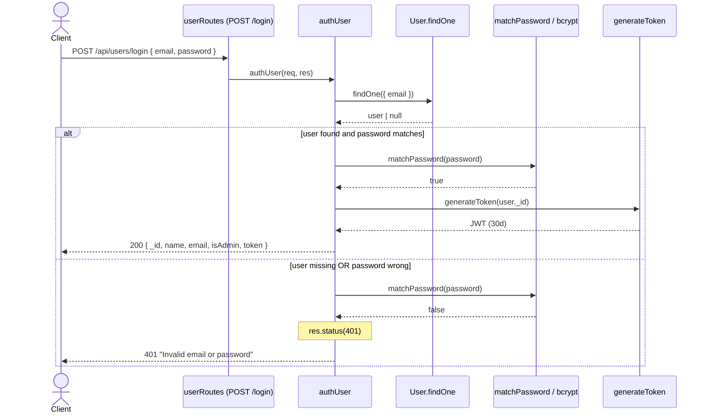

# Overview

`backend/controllers/userController.js` implements all user-account and identity
endpoints for the ProShop API. It is a thin Express controller layer (no service
tier): each handler talks directly to the Mongoose `User` model
(`backend/models/userModel.js`) and is wrapped in `express-async-handler`, so any
thrown `Error` is forwarded to the central error middleware which renders the
status code set via `res.status(...)`.

Routing (`backend/routes/userRoutes.js`):

| Endpoint | Method / Route | Access | Middleware |
|---|---|---|---|
| `registerUser` | `POST /api/users` | Public | — |
| `authUser` | `POST /api/users/login` | Public | — |
| `getUserProfile` | `GET /api/users/profile` | Private | `protect` |
| `updateUserProfile` | `PUT /api/users/profile` | Private | `protect` |
| `getUsers` | `GET /api/users` | Admin | `protect, admin` |
| `deleteUser` | `DELETE /api/users/:id` | Admin | `protect, admin` |
| `getUserById` | `GET /api/users/:id` | Admin | `protect, admin` |
| `updateUser` | `PUT /api/users/:id` | Admin | `protect, admin` |

**Auth model.** `protect` (`authMiddleware.js`) reads a `Bearer` token from the
`Authorization` header, verifies it with `jwt.verify(token, JWT_SECRET)` (no
`algorithms` pinned), loads the user via `findById(decoded.id).select('-password')`
into `req.user`, and 401s on any missing/invalid token. `admin` then 401s unless
`req.user.isAdmin` is truthy.

**Password hashing.** The `userModel` `pre('save')` hook bcrypt-hashes
`password` (salt cost **10**) only when the field `isModified`. `matchPassword`
does `bcrypt.compare`. Hashing therefore happens on `create` (register) and on
any `save` where password changed — never in the controller itself.

**Token issuance.** `generateToken(id)` signs `{ id }` with `JWT_SECRET` and a
fixed **30-day** TTL (no refresh/rotation/revocation). Tokens are returned by
`authUser`, `registerUser`, and `updateUserProfile`.

**Business rules / invariants.** Email is `unique` + `required` at the schema
level. `registerUser` pre-checks `findOne({ email })` and rejects duplicates.
`getUsers` (post-fix, today) and `getUserById` strip the password hash via
`.select('-password')`; `authUser`/`updateUserProfile`/`updateUser` return only a
whitelisted projection (`_id`, `name`, `email`, `isAdmin`, +token where issued),
so the hash never reaches the client. Self-identity for profile routes derives
from `req.user._id` (token-bound), while admin routes key off `req.params.id`.

## Decision Table

| # | Condition | Then-action | Else-action | Edge case |
|---|---|---|---|---|
| 1 | `authUser`: user found AND `matchPassword(password)` true | 200 + user projection + token | 401 `Invalid email or password` | Same generic 401 whether email unknown or password wrong (no user enumeration) |
| 2 | `authUser`: `email` resolves to an existing doc but password wrong | — | 401 `Invalid email or password` | Timing differs (bcrypt runs only when user found) |
| 3 | `registerUser`: `findOne({ email })` returns a doc | 400 `User already exists` | proceed to `create` | TOCTOU: two concurrent registers both pass the check |
| 4 | `registerUser`: `create` returns a truthy user | 201 + projection + token | 400 `Invalid user data` | Missing `name`/`password` → schema `required` validation error (caught as 500-ish by handler, not the 400 branch) |
| 5 | `registerUser`: duplicate email slips past pre-check | — | Mongo E11000 duplicate-key error thrown | Unique index is the real guard; surfaces as generic error |
| 6 | `getUserProfile`/`updateUserProfile`: `findById(req.user._id)` finds user | return profile (update: +token) | 404 `User not found` | `req.user` already loaded by `protect`; 404 only if deleted mid-session |
| 7 | `updateUserProfile`: `req.body.password` truthy | set password → `save` re-hashes | keep existing hash | Empty string is falsy → password unchanged |
| 8 | `updateUserProfile`: `req.body.name`/`email` provided | overwrite field | keep current (`|| user.x`) | Cannot clear a field to empty; no email-format/uniqueness re-validation before save |
| 9 | Any admin route: `protect` sets `req.user` AND `isAdmin` true | run handler | 401 `Not authorized as an admin` | Non-admin with valid token blocked at `admin` middleware |
| 10 | `protect`: header starts with `Bearer` AND `jwt.verify` ok AND user exists | `next()` | 401 token failed / no token | Valid signature but deleted user → `req.user` null → downstream `admin` 401s |
| 11 | `deleteUser`: `findById(req.params.id)` finds user | `user.remove()` + 200 message | 404 `User not found` | No self-delete guard; admin may delete own account |
| 12 | `getUserById`: id found | 200 full doc minus password | 404 `User not found` | Malformed ObjectId → cast error thrown (not a clean 404) |
| 13 | `updateUser`: id found | set name/email, `isAdmin = req.body.isAdmin`, save | 404 `User not found` | `isAdmin` assigned **unconditionally** — omitting it sets `undefined` → schema default `false`, silently demoting admins |
| 14 | `updateUser`: `req.body.isAdmin` is truthy | user becomes admin | user becomes non-admin | Privilege escalation/demotion fully client-controlled by any admin |
| 15 | Any route: `email` supplied as an object (e.g. `{"$gt":""}`) | passed unvalidated into `findOne`/`create` | — | NoSQL operator injection on `authUser`/`registerUser` |

## Sequence Diagram

## Edge Cases

- **Wrong password**: user exists, `matchPassword` returns false → generic 401 `Invalid email or password` (same message as unknown email).
- **Missing/unknown email**: `findOne` returns null, short-circuit skips bcrypt → identical 401 (no enumeration via message, but timing may differ since bcrypt only runs when a user is found).
- **Duplicate email on register**: pre-check `findOne({ email })` returns 400 `User already exists`; the schema `unique` index is the authoritative backstop.
- **NoSQL operator injection via email**: `req.body.email = { "$gt": "" }` is passed straight into `User.findOne({ email })` in `authUser`/`registerUser` (and into `create`) with no type validation — can match the first user or bypass the existence check. **Still open.**
- **Malformed JWT**: `jwt.verify` throws inside `protect`'s try/catch → 401 `Not authorized, token failed`.
- **No `Bearer` prefix / missing header**: `token` stays undefined, falls through to 401 `Not authorized, no token`.
- **Expired token**: 30-day TTL elapsed → `jwt.verify` throws `TokenExpiredError` → 401 token failed. No refresh/rotation path exists, so the user must fully re-login.
- **Algorithm not pinned**: `jwt.verify` omits `algorithms`, leaving the historical alg-confusion surface (compounded by `jsonwebtoken ^8` in deps per Stage-1).
- **Token for deleted user**: signature valid, but `findById(decoded.id)` returns null → `req.user` null → admin routes 401, profile routes 404.
- **Non-admin hitting admin route**: valid token but `isAdmin` false → `admin` middleware returns 401 `Not authorized as an admin`.
- **Self-deletion**: an admin can call `DELETE /api/users/:id` with their own id; no guard prevents removing the last/own admin account.
- **isAdmin escalation/demotion via `updateUser`**: `user.isAdmin = req.body.isAdmin` is set unconditionally — any admin can promote/demote anyone, and omitting `isAdmin` in the body coerces it to `undefined` → schema default `false`, silently stripping admin rights.
- **Concurrent register, same email**: two simultaneous requests can both pass the `findOne` existence check (TOCTOU) before either `create`s; only the unique index saves it, and the loser surfaces a raw E11000 error rather than the friendly 400.
- **Malformed ObjectId in `:id`**: `findById('not-an-id')` throws a CastError instead of returning a clean 404 (`getUserById`/`deleteUser`/`updateUser`).
- **Empty-string field on profile update**: `req.body.name || user.name` means an empty string is ignored — fields cannot be cleared, and a changed email is not re-checked for uniqueness/format before `save`.
- **No password-strength / email-format validation**: register/update accept any non-empty string; weak passwords and invalid emails are persisted. **Still open.**
- **bcrypt cost 10**: hashing uses salt rounds = 10, below the recommended ≥12. **Still open.**
- **Password leak path closed**: `getUsers` (today's Stage-2 fix) and `getUserById` use `.select('-password')`; mutation endpoints return only a whitelisted projection, so the bcrypt hash no longer reaches any client.

## Open Questions

- **NoSQL operator injection** on `req.body.email` in `authUser`/`registerUser` (and `create`): no input typing/sanitization. *Still open* (Stage-1 security A03/MEDIUM).
- **No password-strength or email-format validation** on register/profile-update. *Still open.*
- **30-day JWT TTL with no rotation/refresh/revocation**: a leaked token is valid for a month with no server-side invalidation. *Still open.*
- **bcrypt cost factor 10** (below recommended ≥12). *Still open* (Stage-1 LOW).
- **JWT algorithm not pinned** in `protect` + `jsonwebtoken ^8` CVE exposure — should `algorithms: ['HS256']` be enforced? (Stage-1 HIGH #5.)
- **`updateUser` privilege model**: should `isAdmin` be guarded (e.g. only conditionally applied, last-admin protection) and should self-demotion/self-deletion be blocked?
- **`getUsers` unbounded list**: still returns all users with no pagination (Stage-1 PERF-007) — out of scope for the password fix but open.
- Should `findById` with a malformed ObjectId return a clean 404 instead of a CastError?

## Suggested Characterization Tests

1. **Login success** — seed a user; `POST /login` with correct creds → 200, body has `token` and `isAdmin`, and **no `password` field**.
2. **Login wrong password** — correct email, bad password → 401 `Invalid email or password`.
3. **Login unknown email** — nonexistent email → 401 with the *same* message (pin the no-enumeration contract).
4. **Register success** — new email → 201, token returned, password not echoed.
5. **Register duplicate** — existing email → 400 `User already exists`.
6. **getUsers projection (post-fix)** — admin lists users → 200 array; assert **every element lacks `password`** (locks today's `.select('-password')` fix).
7. **getUserById projection** — admin fetches by id → 200, no `password`; unknown id → 404.
8. **protect: no token** — call `/profile` without header → 401 `Not authorized, no token`.
9. **protect: malformed token** — garbage `Bearer` value → 401 `Not authorized, token failed`.
10. **admin gate** — non-admin valid token hits `GET /api/users` → 401 `Not authorized as an admin`.
11. **updateUserProfile** — change name only, omit password → 200, name updated, login with old password still works (re-hash skipped).
12. **updateUser isAdmin coercion** — `PUT /api/users/:id` with body omitting `isAdmin` → assert resulting `isAdmin` becomes `false` (documents the demotion footgun).
13. **deleteUser** — admin deletes existing id → 200 `User removed`; nonexistent id → 404.
14. **NoSQL injection probe** — `POST /login` with `email` as `{ "$gt": "" }` → assert current behavior (documents the open vuln; flips when sanitization lands).
15. **Concurrent register** — fire two parallel registers with the same new email → assert exactly one 201 and the other errors (pins TOCTOU/unique-index behavior).
