# Spec — AutoPilot n8n Integration

**Модуль:** `backend/routes/autopilotRoutes.js`.
**ADR:** adr-006 (n8n autopilot integration).
**Состояние:** Stage2 fix-3 добавил `protect + admin` на endpoint.

---

## 1. UNDERSTAND

`POST /api/autopilot/feature-control` — серверный прокси к n8n webhook `WF1 — Feature Control`. Цель — скрыть `N8N_API_KEY` от браузерного bundle: фронтенд не должен видеть секрет, поэтому идёт на свой origin (`/api/autopilot/...`), а сервер форвардит запрос на `${N8N_WEBHOOK_URL}/feature-control` с `X-API-Key` header.

Поток:

1. Middleware chain: `protect` → `admin` → `express.json({limit:'16kb'})` → handler.
2. Handler читает `N8N_WEBHOOK_URL` и `N8N_API_KEY` из env. Без URL — 500.
3. `fetch(target, {method:POST, headers:{Content-Type, X-API-Key?}, body, signal: AbortSignal.timeout(5000)})`. Тело — `JSON.stringify(req.body || {})`.
4. Upstream timeout 5s → catch ловит `TimeoutError` → 504. Любая другая network ошибка → 502.
5. Если upstream вернул tex → пробуем `JSON.parse`. Если не JSON — оборачиваем в `{success: upstream.ok, message: text || HTTP <code>}`. Передаём клиенту с upstream.status.

Использование: AutoPilot UI (admin) — кнопка/команда, которая просит n8n workflow выполнить feature-control действие (например, привязка слаг-фичи к расписанию rollout). Workflow в n8n затем может писать обратно в features.json через MCP-features HTTP-туннель.

---

## 2. DECISION TABLE

| Condition | Then | Else | Edge |
|---|---|---|---|
| user не аутентифицирован | 401 (protect) | продолжаем | Stage2 fix-3 покрыл |
| user не admin | 401 (admin) | продолжаем | Stage1 ARCH-07: должен быть 403 |
| body > 16 KB | 413 (express.json limit) | parsed | защита от unbounded body |
| `N8N_WEBHOOK_URL` undefined | 500 | продолжаем | env mis-config — fail loudly |
| `N8N_API_KEY` undefined | пропустить X-API-Key | добавить header | upstream может отказать без ключа — passthrough error code |
| timeout > 5s | 504 + {success:false, message} | продолжаем | AbortSignal.timeout — node 18+ |
| TypeError network | 502 | продолжаем | DNS fail, refused conn |
| upstream возвращает не-JSON | wrap `{success:upstream.ok, message:text}` | parse | text=binary blob — корректно ли? wrap |
| upstream 4xx/5xx | passthrough status + payload | — | error message может содержать sensitive n8n internals |

---

## 3. SEQUENCE DIAGRAM

```mermaid
sequenceDiagram
  participant U as Browser (AutoPilot UI)
  participant E as Express /api/autopilot/feature-control
  participant MW as protect + admin
  participant N as n8n webhook

  U->>E: POST /api/autopilot/feature-control (Bearer admin JWT, body JSON)
  E->>MW: chain
  MW-->>E: req.user (admin)
  E->>E: validate env (N8N_WEBHOOK_URL)
  E->>N: fetch POST ${URL}/feature-control (X-API-Key: ***, body, timeout 5s)
  alt success
    N-->>E: 200 JSON
    E-->>U: 200 + payload (passthrough)
  else timeout
    Note over E: AbortSignal fires
    E-->>U: 504 {success:false, message:"Upstream error: ..."}
  else network err
    E-->>U: 502 {success:false, message:...}
  else upstream 4xx/5xx
    N-->>E: <code> + text
    E-->>U: <code> + parsed or wrapped JSON
  end
```

---

## 4. EDGE CASES

- **SSRF surface.** `target = base.replace(/\/+$/, '') + '/feature-control'` — path фиксированный, host из env (НЕ user-controlled). Безопасно от SSRF *через body*. Но если `N8N_WEBHOOK_URL` указан на internal IP — admin user может слать любой body. Mitigation: env validate at startup (не сделано).
- **Body passthrough as-is.** `req.body` форвардится без schema. n8n принимает любой shape. Если n8n workflow exposes destructive op без своей проверки — risk. Defense-in-depth: добавить zod schema на admin payload (Stage3 architecture-mate возможно flag).
- **Header injection через body.** body — JSON.stringify, безопасно — fetch не интерпретирует body как headers.
- **`X-API-Key` only if present.** Если env пуст — header не шлётся → upstream без auth. Stage1 SEC: должно fail closed.
- **Timeout granularity.** 5s жёсткий. Для длительных n8n workflows (~30s) — таймаут. Пользователь видит 504, workflow продолжает выполняться (n8n side-effect). UI должно опросом проверять статус — этого нет.
- **Upstream Content-Type не проверяется.** n8n может вернуть HTML error page — попадёт в catch JSON.parse → wrap. OK.
- **Response status leak.** Passthrough upstream status — admin видит реальные коды n8n (например, n8n auth fail = 401). Информативно для отладки, но даёт сигнал злоумышленнику.
- **Sensitive в `message`.** Если upstream возвращает «Internal n8n workflow id=XYZ error», admin видит. Утечка топологии. Не критично, т.к. admin-only.
- **Concurrent calls.** Нет rate-limit per admin user. Admin может в цикле дёрнуть webhook → DoS на n8n. Mitigation: rate-limit middleware.
- **`req.body` undefined.** `JSON.stringify(req.body || {})` → "{}" — OK fallback.
- **Token rotation.** N8N_API_KEY изменился — рестарт backend нужен (нет hot reload env). Документировано в `local-setup.md`?
- **Cloudflare tunnel URL ephemeral.** Из `CLAUDE.md`: URL меняется при каждом рестарте `mcp-tunnel`. AutoPilot endpoint ↔ n8n webhook URL должен быть stable (не tunnel). Документировано в runbook.

---

## 5. Open Questions

- **n8nClient extraction (ARCH-DELTA-04)** — ADR-006 invariant #6 требует `backend/services/n8nClient.js`. ~30 LoC. Когда?
- **Zod schema на body** — ADR-006 invariant #3 рекомендует. AutoPilot UI отправляет известный shape; должна ли быть валидация on backend перед форвардом?
- **SSRF allowlist** — Stage2 fix-3 отложил. Должен ли быть `URL.parse(N8N_WEBHOOK_URL)` + check host в whitelist startup?
- **Timeout 5s — конфигурируемо?** Long-running workflows фейлятся. Параметр на route либо env var?
- **Response size cap (PERF-D10)** — `await upstream.text()` буферизует всё. Должна быть `Content-Length` проверка / `response.body` streaming с cap?
- **Audit log** — ADR-006 open issue. Кто/когда дёрнул AutoPilot — должно быть log entry?
- **`X-API-Key` если empty** — fail-closed или passthrough? Сейчас passthrough.
- **Concurrent rate limit** — нужен ли express-rate-limit middleware?
- **Error message sanitization** — leak host/IP в `e.message`. Должна быть generic «Upstream unavailable»?

## 6. Suggested Characterization Tests

| # | Scenario | Assertion |
|---|---|---|
| AP1 | POST /api/autopilot/feature-control без auth | 401 |
| AP2 | POST с non-admin JWT | 401 |
| AP3 | POST с admin JWT + body > 16 KB | 413 |
| AP4 | POST с admin + body OK + `N8N_WEBHOOK_URL` unset | 500 «N8N_WEBHOOK_URL is not configured» |
| AP5 | POST с admin + mock n8n возвращает 200 JSON | 200 + passthrough payload |
| AP6 | POST с admin + mock n8n возвращает 200 plain text | 200 + `{success:true, message: '<text>'}` (wrapped) |
| AP7 | POST с admin + mock n8n hangs > 5s | 504 + `{success:false, message:'Upstream error: ...'}` |
| AP8 | POST с admin + mock n8n connection refused | 502 + `{success:false, ...}` |
| AP9 | POST с admin + mock n8n returns 401 | passthrough 401 + payload |
| AP10 | POST с admin + `N8N_API_KEY` set | mock n8n receives request with `X-API-Key: <value>` |
| AP11 | POST с admin + `N8N_API_KEY` empty | mock n8n receives request БЕЗ X-API-Key |
| AP12 | POST с admin + body undefined | n8n receives `{}` |
| AP13 | POST с admin + body с trailing slash в URL `N8N_WEBHOOK_URL='https://x/'` | target = 'https://x/feature-control' (no double slash) |
| AP14 | POST с admin + invalid JSON body | 400 (express.json parse error) |

Implementation hint: переиспользовать `homework/M6/stage2-fix-top3/tests/test-auth-and-integration-routes.js`. Для AP5-AP13 — `nock` или kustom fetch mock; для AP7 timeout — fake timers либо `nock().delay()`.

## Cross-refs

- ADR-006 (n8n autopilot integration).
- Stage1 ARCH-05 (integration logic в router — не вынесено в service layer).
- Stage2 fix-3 (`fix-3-auth-and-integration-routes.md`).
- Tests: `homework/M6/stage2-fix-top3/tests/test-auth-and-integration-routes.js`.
- `runbooks/feature-flag-toggle.md` — операционная сторона AutoPilot.
