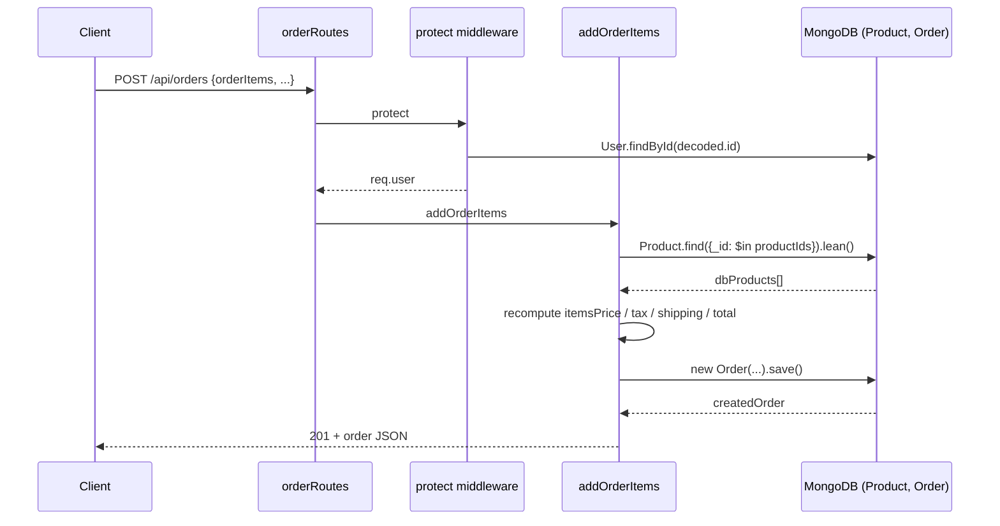
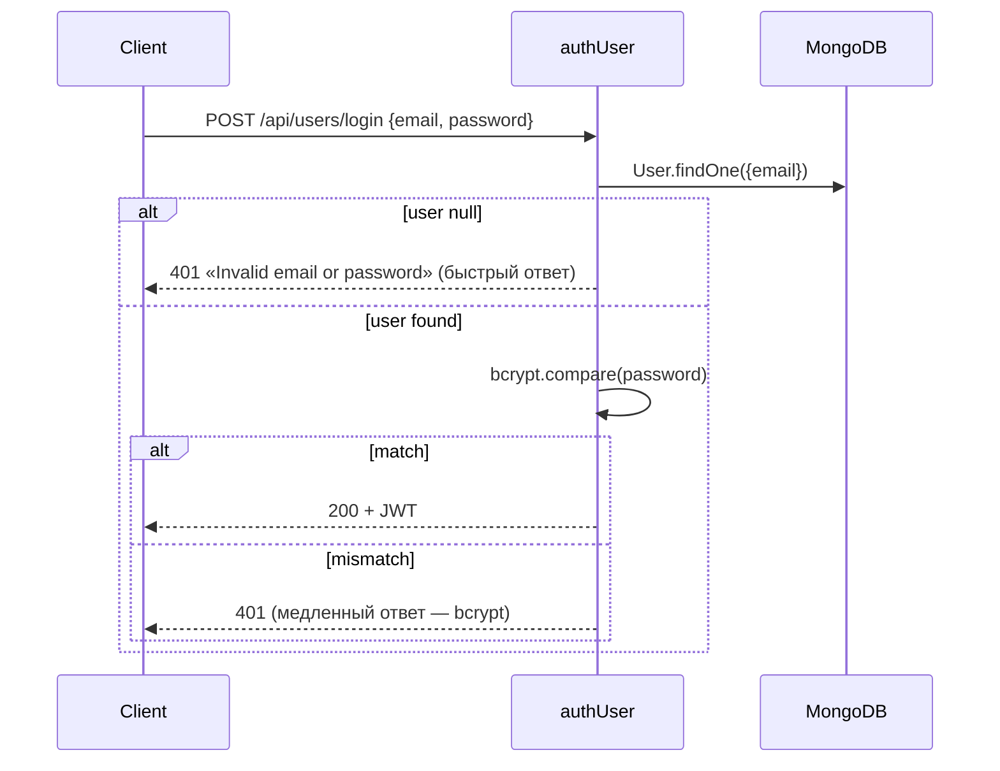

# Spec — backend/controllers

**Модули:** `orderController.js`, `productController.js`, `userController.js`.
**Зависимости:** `backend/models/*`, `backend/utils/featureFlag.js`, `backend/utils/generateToken.js`.
**Состояние:** Stage2 fixes (fix-2 order, fix-3 upload+autopilot) уже применены.

---

## 1. UNDERSTAND

Контроллеры реализуют бизнес-логику трёх ресурсов REST API:

**`orderController`** — жизненный цикл заказа. `addOrderItems` (POST /api/orders) валидирует список товаров, **рекомпьютит цены на сервере** (Stage2 fix-2): подгружает `Product` из БД по `_id`, отбрасывает клиентские `price/totalPrice`, считает `itemsPrice` сумму `price*qty`, шипинг ($100 если itemsPrice ≤ $100 иначе 0), налог 15%. `getOrderById`/`updateOrderToPaid` ограничены `isOwnerOrAdmin` helper (Stage2 fix-2) — non-admin user читает/оплачивает только свои заказы. `updateOrderToPaid` пишет `paymentResult` из PayPal callback (id, status, update_time, payer.email) и ставит `isPaid=true`. `updateOrderToDelivered` (admin) — `isDelivered=true`. `getMyOrders` — фильтр по `user`. `getOrders` (admin) — `find({})` без пагинации (Stage1 PERF finding).

**`productController`** — каталог + reviews. `getProducts` — keyword search через `$regex` (Stage1: regex injection в keyword, Stage2 НЕ пофикшен), pagination size=10. `getProductById` фильтрует reviews по `status === 'approved'`. `createProductReview` использует `isFeatureEnabled('reviews_moderation')` → новый review получает `status: 'pending'` или `'approved'`. Multer images (multer-config в `productRoutes.js`, Stage2 fix-3 ужесточил: 3 файла, 2MB, UUID-имена, mime-whitelist). `suggestProducts` и `getProductRecommendations` — оба под feature-flag (`search_autosuggest`, `product_recommendations`); regex в `suggestProducts` экранирован (`escaped`); прайм-вызов через `optionalProtect`. `getPendingReviews` (admin) — full scan + JS filter (Stage1 PERF). `moderateReview` — approve/reject + пересчёт product.rating / numReviews.

**`userController`** — auth + admin user management. `authUser` (POST /login) ищет user по email, сверяет bcrypt через `matchPassword`, выдаёт JWT через `generateToken`. `registerUser` создаёт user (UNIQUE email check). `getUserProfile` / `updateUserProfile` — self-service по `req.user._id`. Admin endpoints: `getUsers`, `getUserById`, `deleteUser`, `updateUser` (Stage1 SEC: `updateUser` пишет `isAdmin = req.body.isAdmin` без валидации → undefined silently demotes; не пофикшено).

---

## 2. DECISION TABLE

### orderController.addOrderItems

| Condition | Then | Else | Edge |
|---|---|---|---|
| `orderItems.length === 0` | 400 «No order items» | продолжаем | пустой массив vs `undefined` (короткое замыкание `orderItems && length===0` пропускает `undefined`) |
| `giftMessage.length > 200` | 400 | продолжаем | `null`/non-string не валидируется |
| `Product._id` не найден в БД | 400 «Product not found» | используем серверную цену | расхождение клиент↔сервер цена — silent override |
| `qty` не целое 1..99 | 400 «Invalid qty» | принимаем | `qty="3"` (string) проходит через `Number()` |
| `itemsPrice > 100` | shipping=0 | shipping=100 | edge: itemsPrice=100.00 → shipping=100 (НЕ free; «`>`» строгий) |

### orderController.getOrderById / updateOrderToPaid

| Condition | Then | Else | Edge |
|---|---|---|---|
| order не найден | 404 | продолжаем | `req.params.id` invalid ObjectId → cast error → 500 (нет валидации) |
| `req.user.isAdmin === true` | разрешить | проверить owner | admin читает любой order |
| `String(order.user._id) === String(req.user._id)` | разрешить | 403 | populated vs unpopulated `order.user` — helper покрывает оба |

### productController.getProducts

| Condition | Then | Else | Edge |
|---|---|---|---|
| `req.query.keyword` truthy | `$regex: keyword, $options: 'i'` | пустой фильтр | **regex injection: keyword=`.*` full scan, keyword=`(a+)+$` ReDoS — Stage1 SEC не пофикшен** |
| `req.query.pageNumber` invalid | page=1 (через `Number()...||1`) | page=Number(pageNumber) | `pageNumber=-1` → skip отрицательный |

### productController.createProductReview

| Condition | Then | Else | Edge |
|---|---|---|---|
| Product не найден | 404 | продолжаем | — |
| `alreadyReviewed` (не rejected) | 400 «Product already reviewed» | создать review | rejected review — позволяет повторно |
| `moderationEnabled` (flag) | status='pending' | status='approved' | flag меняется в полёте — гонка (5s cache) |
| `req.files` есть | images = pathlist | images = [] | multer-limit нарушен → middleware reject раньше |

### userController.authUser

| Condition | Then | Else | Edge |
|---|---|---|---|
| user найден & bcrypt match | 200 + token | 401 «Invalid email or password» | timing attack: bcrypt всегда вызывается? нет — short-circuit на user==null. ⚠ user enumeration через response time |
| user null | 401 | — | нет rate-limit / lockout (Stage1 SEC) |

### userController.updateUser (admin)

| Condition | Then | Else | Edge |
|---|---|---|---|
| user найден | apply changes, save | 404 | **`user.isAdmin = req.body.isAdmin` — если `isAdmin` отсутствует в body → `undefined` → mongoose default `false` → silent demote (Stage1 SEC)** |

---

## 3. SEQUENCE DIAGRAM

### addOrderItems happy path

### authUser error path

---

## 4. EDGE CASES

- **Cast error на `req.params.id`.** `Order.findById('notAnObjectId')` → mongoose `CastError` → errorMiddleware 500. Stage1 не пофикшен — должен быть 400.
- **Pagination overflow.** `pageNumber=Infinity` или огромный — `skip` принимает, возвращает пустой массив; не валится, но даёт сигнал злоумышленнику.
- **`itemsPrice === 100.00`.** Free-shipping порог exclusive (`>`), пользователь платит $100 шипинг ровно на $100 cart. Бизнес-edge.
- **Race condition: cart freeze + price change.** `addOrderItems` грузит actual price из БД на момент POST. Если admin меняет price между «открыл корзину» и «нажал pay» — пользователь платит новую. UX-edge, не security.
- **JWT в `Authorization` header без `Bearer ` префикса.** `protect` обрабатывает только `startsWith('Bearer')` (без пробела!) — `Bearerfoo` пройдёт `startsWith`, но `split(' ')[1]` вернёт undefined → jwt.verify throw → 401. Хрупко.
- **Review images: race.** Multer пишет файл ДО валидации в контроллере. Если контроллер кинет 404 «Product not found» — файлы остаются на диске. Disk-leak.
- **`updateUser` silent demote.** Admin POST `{name: "X"}` без `isAdmin` — целевой user теряет admin. См. § 2 decision table.
- **`updateOrderToPaid` race.** Два PayPal callback на один order одновременно — оба сетят `isPaid=true`, оба сохраняют, последний выигрывает (idempotent в данном случае — ОК, но `paymentResult` теряется одного из них).
- **`getMyOrders` без лимита.** Пользователь с 10k заказов — full collection scan + сериализация. Stage1 PERF.
- **bcrypt timing.** `user==null` → быстрый ответ (no bcrypt). `user found` → ~100ms bcrypt. Различие в задержке — user enumeration. Mitigation: всегда вызывать bcrypt на dummy hash.

---

## 5. Open Questions

- **`shippingPrice` константа $100 при itemsPrice ≤ $100.** Бизнес-правило интуитивно странное (shipping = cart). Подтверждено по `addOrderItems` коду, но это намеренный teaching artifact или баг? `dev-history.md` не упоминает.
- **`updateOrderToDelivered` без `admin` middleware?** `orderRoutes.js:17` — `protect, admin, updateOrderToDelivered` присутствует, ОК. Но контроллер сам по себе НЕ проверяет (поверх middleware). Если кто-то прицепит роут заново без admin — silent failure. Стоит добавить runtime-проверку?
- **`getMyOrders` сортировка.** Без `.sort()` — порядок зависит от Mongo index. Подразумевается chronological newest-first или нет? Frontend ожидает определённый порядок?
- **`createProduct` создаёт sample-entry с `name='Sample name'`.** Admin сразу редактирует через PUT. Если admin закрыл вкладку — sample-product остаётся в БД. Cleanup?
- **`createProductReview` images — где валидируется размер total payload?** Multer limit 3 файла × 2MB = 6MB; comment без длины-лимита может быть произвольным.
- **`isFeatureEnabled` traffic bucket в `createProductReview`** — параметр `bucket` парсится из header клиента. Reviews_moderation flip — пользователь может форсить bypass moderation? Cross-ref `feature-flags-layer-spec.md`.
- **Mongoose strict mode** для Order — `req.body.shippingAddress`/`paymentMethod` записываются as-is. Extra keys silently dropped? Зависит от schema config.

## 6. Suggested Characterization Tests

Тесты должны зафиксировать текущее (возможно багообразное) поведение, чтобы рефакторинг не сломал контракт.

| # | Scenario | Assertion |
|---|---|---|
| C1 | `addOrderItems` с `totalPrice: 0` в body | server возвращает 201, но `order.totalPrice` ≠ 0 (recomputed) |
| C2 | `addOrderItems` с product._id, отсутствующим в БД | 400 «Product not found: ...» |
| C3 | `addOrderItems` с `qty: 0`, `qty: 100`, `qty: '3'` (string) | первые два — 400; string '3' — принят (через Number coercion) |
| C4 | `addOrderItems` с `itemsPrice === 100.00` | `shippingPrice === 100` (НЕ free) |
| C5 | `getOrderById` от non-owner, non-admin | 403 |
| C6 | `getOrderById` admin читает чужой order | 200 |
| C7 | `getOrderById` с invalid ObjectId (`'foo'`) | текущее: 500 cast error; ожидаемое: 400 |
| C8 | `updateOrderToPaid` non-owner, non-admin | 403 |
| C9 | `updateOrderToPaid` без `req.body.payer` (опциональная цепочка) | 200, `email_address` undefined в paymentResult |
| C10 | `getProducts` с keyword=`.*` | возвращает 10 (paginated), full scan happens |
| C11 | `getProducts` с keyword=`(a+)+$` | таймаут / ReDoS detection (потенциально hang) |
| C12 | `getProductById` с product у которого 5 reviews (3 approved, 2 pending) | response.reviews.length === 3 |
| C13 | `createProductReview` дважды от одного user | 400 «Product already reviewed» |
| C14 | `createProductReview` после `rejected` review того же user | 201 (можно повторно) |
| C15 | `createProductReview` с `reviews_moderation` Testing 0% | review.status === 'approved' |
| C16 | `createProductReview` admin user + `reviews_moderation` Testing | review.status === 'pending' (admin always sees Testing) |
| C17 | `authUser` non-existent email | 401 быстрый ответ (без bcrypt) |
| C18 | `authUser` existing email + wrong password | 401 медленный ответ (~100ms) |
| C19 | `updateUser` admin POST body без `isAdmin` | target.isAdmin становится `undefined`→`false` (silent demote) |
| C20 | `getUsers` admin | возвращает массив всех users БЕЗ password hash |

Implementation hint: переиспользовать setup из `homework/M6/stage2-fix-top3/tests/test-order-endpoints.js` (jest + supertest + mongodb-memory-server).

## Cross-refs

- ADR-003 (JWT vs session).
- ADR-007 (feature-flag storage — `isFeatureEnabled` source of truth).
- Stage1: SEC findings A-D, ARCH-08..11.
- Stage2 fix-2 (`fix-2-order-endpoint-hardening.md`) — applied.
- Tests: `homework/M6/stage2-fix-top3/tests/test-order-endpoints.js`.
