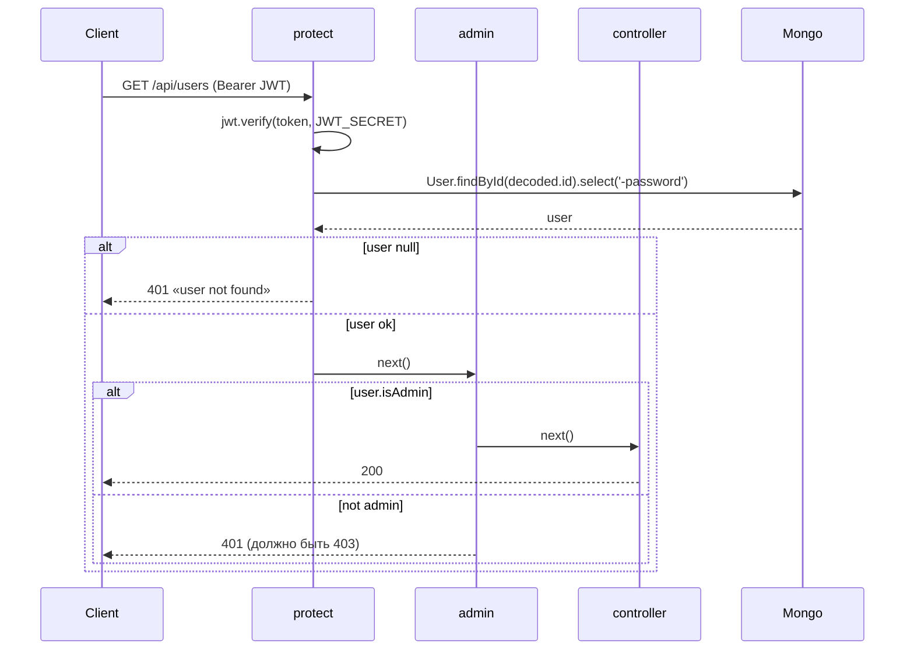
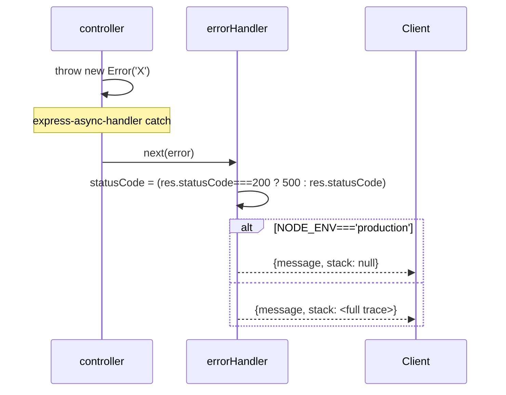

# Spec — backend/middleware

**Модули:** `authMiddleware.js`, `errorMiddleware.js`.

---

## 1. UNDERSTAND

**`authMiddleware`** содержит три функции:

- `protect` — обязательная JWT-проверка. Извлекает `Bearer <token>` из `Authorization`, декодирует через `jwt.verify(token, JWT_SECRET)`, грузит `User.findById(decoded.id).select('-password')` в `req.user`. Если token отсутствует или невалиден — 401. Если user удалён из БД (token живой, user нет) — явно проверяется (`if (!req.user) 401`) — без этой проверки `req.user` будет `null` дальше по цепочке.
- `admin` — синхронный гард после `protect`. Если `req.user.isAdmin` — `next()`, иначе 401 «Not authorized as an admin» (Stage1 ARCH-07: должен быть **403**, а не 401, потому что user аутентифицирован).
- `optionalProtect` — мягкая JWT-проверка. Если header есть и валидный — `req.user` populated. Если нет или невалидный — `req.user` остаётся `undefined`, middleware пропускает дальше. Используется в `suggestProducts`/`getProductRecommendations` для traffic-bucket распределения с учётом isAdmin при наличии токена.

**`errorMiddleware`** содержит два:

- `notFound` — 404 handler для несуществующих маршрутов. Создаёт Error → `next(error)` → попадает в `errorHandler`.
- `errorHandler` — global error handler. Если `res.statusCode === 200` (т.е. контроллер не вызвал `res.status(...)`) — выставляет 500. Возвращает `{message, stack}` где stack `null` в production иначе full trace (Stage1 SEC MED — info leakage default unsafe).

---

## 2. DECISION TABLE

### protect

| Condition | Then | Else | Edge |
|---|---|---|---|
| `authorization` startsWith `'Bearer'` | extract token, verify | 401 «no token» | `'Bearer'` без пробела (`Bearerxxx`) — проходит startsWith! |
| `jwt.verify` ok | `User.findById(decoded.id)` | 401 «token failed» | алгоритм НЕ закреплён в `verify` — HS256 принимается, `none` нет (jwt v8 default безопасен) |
| `req.user` найден | `next()` | 401 «user not found» | user удалён, JWT живой 30d — пользователю надо relogin |
| catch | `console.error` + 401 | — | **`console.error(error)` логирует JWT error object — раскрывает структуру токена в stdout** (Stage1 SEC MED) |

### admin

| Condition | Then | Else | Edge |
|---|---|---|---|
| `req.user.isAdmin === true` | `next()` | 401 (должно быть 403) | вызов без `protect` → `req.user` undefined → throw `TypeError` → 500 (нужна явная проверка `req.user`) |

### optionalProtect

| Condition | Then | Else | Edge |
|---|---|---|---|
| header есть & startsWith `'Bearer '` (с пробелом) | try verify | пропустить | strict `'Bearer '` (отличается от `protect`!) |
| verify throw | swallow + продолжить | — | silent fail — нет audit log |

### errorHandler

| Condition | Then | Else | Edge |
|---|---|---|---|
| `res.statusCode === 200` | 500 | keep statusCode | контроллер забыл `res.status(...)` → 500 fallback |
| `NODE_ENV === 'production'` | stack=null | full stack | **default НЕ production → stack утекает локально/preview** (Stage1 SEC MED) |

---

## 3. SEQUENCE DIAGRAM

### protect happy + admin gate

### errorHandler

---

## 4. EDGE CASES

- **`Bearer ` без пробела** — `protect` принимает (startsWith) но split фейлит → token=undefined → jwt.verify throw → 401. Поведение корректное, но различие с `optionalProtect` (там strict `'Bearer '`).
- **JWT никаких claims кроме `id`.** Нет `iat/exp/iss` проверок (по умолчанию `expiresIn:'30d'` создаёт `exp`). Algorithm не закреплён в `verify` — допускает любой алгоритм, поддерживаемый библиотекой.
- **`admin` без предшествующего `protect`.** Маршрут `[admin, handler]` без protect — `req.user` undefined → `req.user && req.user.isAdmin` → false → 401 (а не 500 — благодаря short-circuit). Логически правильно, но скрывает программистскую ошибку.
- **Token revocation.** Нет blacklist. Logout — клиент удаляет JWT из localStorage; сервер всё равно принимает 30 дней (Stage1 SEC ADR-003 accepted debt).
- **JWT_SECRET длина.** Нет проверки на старте — пустой secret → jwt.sign без ошибки → cryptographically broken (Stage1 SEC MED).
- **Race: user удалён после JWT issue.** `protect` грузит из БД на каждый запрос → выявит. Cost: 1 query/request (no cache).
- **errorHandler с не-Error объектом.** `throw 'string'` или `throw {message:'X'}` без stack → `err.stack` undefined → response `{message, stack: undefined}` (JSON drops undefined). Не падает.
- **notFound + errorHandler chain.** `notFound` ставит 404 + `next(error)` → `errorHandler` видит statusCode=404 (не 200) → keep 404. OK.
- **`optionalProtect` swallow.** Невалидный токен пользователь не узнаёт. Hint: можно использовать для пробинга без логов — пишет в нормальный API audit, не security audit. Stage1 LOW.

---

## 5. Open Questions

- **JWT_SECRET валидация на старте.** Stage1 SEC MED — нет проверки длины/наличия. Должна ли быть startup-assertion (server.js)? CLAUDE.md упоминает требование `.env`, но не валидирует runtime.
- **`admin` HTTP code — 401 vs 403.** Stage1 ARCH-07 предлагает 403. Стоит ли менять — фронтенд возможно завязан на 401 для redirect-on-logout. Контракт?
- **`optionalProtect` vs `protect` различие в `'Bearer'` strict.** Намеренное? `protect` принимает `'Bearer'` (без пробела) startsWith, `optionalProtect` strict `'Bearer '`. Скорее всего опечатка.
- **`console.error(error)` в `protect`.** Должен быть structured logger? Stage1 рекомендует. Logger в проекте отсутствует.
- **`errorHandler` default stack leak.** Безопаснее default = sanitize, опционально verbose. Текущий ставит `null` ТОЛЬКО при NODE_ENV===production. ENV-misconfig (отсутствие NODE_ENV) — leak.
- **Token revocation strategy.** ADR-003 принимает 30d JWT debt. Будущий refresh-token flow меняет signature `protect`?
- **`optionalProtect` swallow non-Bearer schemes.** `Authorization: Basic ...` игнорируется silent. Должен ли логгировать unexpected scheme?

## 6. Suggested Characterization Tests

| # | Scenario | Assertion |
|---|---|---|
| M1 | request без `Authorization` header через `protect` | 401 «Not authorized, no token» |
| M2 | request с `Authorization: Bearer <expired_jwt>` | 401 «Not authorized, token failed» |
| M3 | request с `Authorization: Bearer <jwt_тот_token_но_user_удалён>` | 401 «Not authorized, user not found» |
| M4 | request с `Authorization: Bearer` (без token) | 401 (token=undefined → verify throw) |
| M5 | request с `Authorization: Bearerxxx` (без пробела + invalid) | 401 (startsWith пропускает, verify throw) |
| M6 | `admin` после `protect` где user.isAdmin === false | 401 «Not authorized as an admin» |
| M7 | `admin` без предшествующего `protect` (req.user undefined) | 401 (благодаря short-circuit), НЕ 500 |
| M8 | `optionalProtect` без header → следующий handler видит req.user undefined | handler executes |
| M9 | `optionalProtect` с invalid token → следующий handler видит req.user undefined | handler executes (silent swallow) |
| M10 | `optionalProtect` с valid token → req.user populated | handler sees user |
| M11 | `notFound` для несуществующего route | response 404 + body.message содержит url |
| M12 | controller throws Error без `res.status(...)` | errorHandler returns 500 |
| M13 | controller throws + `res.status(400)` | errorHandler returns 400 (not 500) |
| M14 | errorHandler в NODE_ENV='production' | response.stack === null |
| M15 | errorHandler в NODE_ENV='development' | response.stack содержит trace |
| M16 | errorHandler с throw non-Error (`throw 'str'`) | response.message === 'str' (без crash) |

Implementation hint: дополнить `homework/M6/stage2-fix-top3/tests/test-auth-and-integration-routes.js` или добавить отдельный `test-middleware.js`.

## Cross-refs

- ADR-003 (JWT vs session).
- Stage1 ARCH-07, ARCH-12, SEC MED auth.
- Stage2: `protect`/`admin` НЕ менялся (Stage2 fix-3 только добавил `protect, admin` на autopilot/upload — middleware код тот же).
- Tests: `homework/M6/stage2-fix-top3/tests/test-auth-and-integration-routes.js`.
