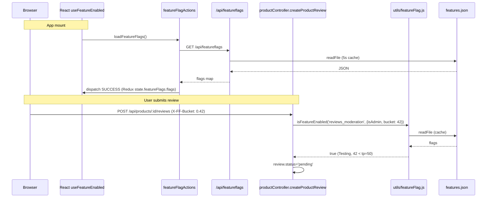
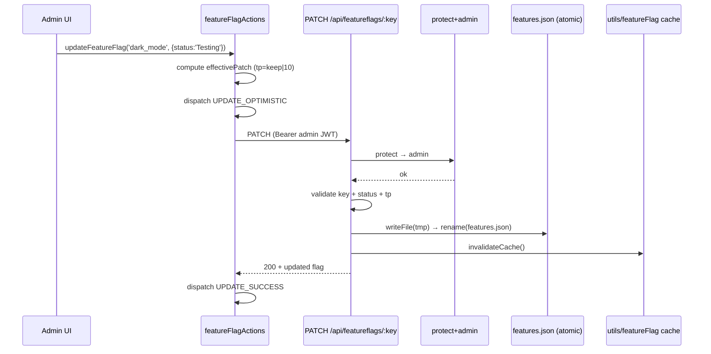

# Spec — Feature Flags Layer

**Слой:** end-to-end feature-flag pipeline от хранилища до UI.
**Компоненты:**

- Storage: `backend/features.json`.
- Backend read API: `backend/routes/featureFlagRoutes.js` + `backend/utils/featureFlag.js`.
- Frontend Redux: `frontend/src/actions/featureFlagActions.js` + `featureFlagReducers.js` + `constants/featureFlagConstants.js`.
- Frontend hook: `frontend/src/hooks/useFeatureEnabled.js`.
- Admin write: PATCH `/api/featureflags/:key` (Express) + MCP tools (см. `mcp-features-spec.md`).
- ADR: adr-007.

---

## 1. UNDERSTAND

Feature-flag слой решает три задачи:

1. **Backend evaluation** (`utils/featureFlag.js`). Контроллеры (например, `productController.createProductReview`) вызывают `isFeatureEnabled(key, {isAdmin, bucket})`. Реализация: 5s in-memory cache → `Enabled` → true, `Testing` & tp>0 → isAdmin или `bucket < traffic_percentage`. `Disabled` → false. `bucket` парсится из header `X-FF-Bucket` (0..1 от клиента) либо `Math.random()*100` fallback.
2. **Frontend Redux state.** На mount приложения (`App.js`) `loadFeatureFlags()` GET `/api/featureflags` → массив flags в `state.featureFlags.flags`. Optimistic update через `updateFeatureFlag(key, patch)` (admin UI AutoPilot): patch отправляется PATCH, при 401 — silent return; при error — rollback к `previous`. Merge logic в reducer: при `FEATURE_FLAGS_SUCCESS` сохраняет локальные pending-изменения поверх свежего сервера.
3. **Frontend evaluation** (`useFeatureEnabled(key)`). Хук читает Redux flags + userInfo, ищет flag по key. `Enabled` → true, `Testing & tp>0` → isAdmin OR `getOrCreateTrafficBucket() < tp`. Bucket: persistent в `sessionStorage['ff_traffic_bucket']` (random при первом обращении), нормализован *100.

PATCH endpoint (`featureFlagRoutes.js`) защищён `protect + admin`, валидирует key через `/^[a-z][a-z0-9_-]{0,63}$/`, статус из whitelist, traffic 0..100. Atomic write tmp+rename. Cache invalidate после write. Не путать с MCP-features процессом (см. `mcp-features-spec.md`) — два независимых writer'а в один файл.

---

## 2. DECISION TABLE

### backend/utils/featureFlag.js — isFeatureEnabled

| Condition | Then | Else | Edge |
|---|---|---|---|
| cache hit (< 5s old) | return cached | reload | mid-flight write от MCP не виден до 5s |
| flag missing | false | продолжаем | typo в key → silent false (нет warning) |
| status==='Enabled' | true | продолжаем | tp игнорируется |
| status==='Testing' & tp>0 & isAdmin | true | продолжаем | admin всегда видит Testing |
| Testing & bucket<tp | true | false | bucket=null → `Math.random()*100` per-request → non-deterministic для одного user |
| status==='Disabled' | false | — | — |

### featureFlagRoutes.PATCH /:key

| Condition | Then | Else | Edge |
|---|---|---|---|
| !FEATURE_KEY_RE.test(key) | 400 | продолжаем | блокирует `__proto__`/uppercase/spaces |
| !Object.hasOwn(data, key) | 404 | продолжаем | `Object.hasOwn` (не `in`) — игнорирует proto |
| status not in [Enabled, Testing, Disabled] | 400 | продолжаем | case-sensitive |
| tp not int 0..100 | 400 | продолжаем | float reject |
| status==='Enabled' & tp undef | tp=100 | — | mirror MCP логики |
| status==='Disabled' & tp undef | tp=0 | — | mirror MCP |
| status==='Testing' & tp undef | keep если 1..99 иначе 10 | — | mirror MCP |
| atomic write fail | throw → errorHandler 500 | invalidateCache + 200 | tmp оставлен → следующая попытка перепишет |

### useFeatureEnabled (frontend)

| Condition | Then | Else | Edge |
|---|---|---|---|
| flag missing in Redux | false | продолжаем | до loadFeatureFlags() — все hooks false |
| status==='Enabled' | true | продолжаем | — |
| status==='Testing' & tp>0 & isAdmin | true | продолжаем | admin override mirror backend |
| Testing & bucket<tp | true | false | **bucket persistent в sessionStorage — но client может удалить → реролл; клиент тривиально форсит true (выставив bucket=0)** |

### featureFlagActions.updateFeatureFlag

| Condition | Then | Else | Edge |
|---|---|---|---|
| previous flag missing | return early (silent) | продолжаем | race: load not finished |
| 401 от PATCH | silent return, NO rollback | dispatch FAIL | session expired — UI остаётся с optimistic state до next loadFeatureFlags |
| network error | dispatch FAIL → rollback к previous | success update | — |

---

## 3. SEQUENCE DIAGRAM

### Backend gating + bucket flow

### Admin AutoPilot toggle

---

## 4. EDGE CASES

- **Bucket bypass на фронте.** `sessionStorage.setItem('ff_traffic_bucket', '0')` → `0 * 100 = 0 < tp` всегда → user форсит включение любой Testing-фичи. Backend имеет тот же баг через header `X-FF-Bucket: 0` — `parseBucketHeader` принимает любое значение 0..1. **Server MUST not trust client bucket для security-фичей.** Stage1 SEC.
- **Race: PATCH vs MCP write.** Express atomic (tmp+rename) — safe. MCP direct writeFileSync — может перетереть. Окно: MCP read → wait → Express patch → write → MCP write (overwrites Express). Lost update. ADR-007 предписывает «shared store module»; не реализовано.
- **Cache TTL 5s.** Прод-флип через MCP — frontend видит через ≤ 5s + следующий poll loadFeatureFlags (если есть). Если frontend НЕ polls — состояние drift до refresh страницы.
- **Optimistic update + 401.** UI остаётся с optimistic state, бэк не записал. Следующий loadFeatureFlags перетрёт. Меж тем — admin видит UI как «уже Testing», но другие пользователи нет. UX drift.
- **`FEATURE_FLAGS_SUCCESS` merge.** Reducer keeps pending local entries поверх свежих. Если PATCH SUCCESS пришёл, но pending не очистился (баг dispatch order) — навсегда отображает локальное.
- **Flag deletion.** Если admin удалит flag (через прямое редактирование features.json — UI не поддерживает) — Redux state.flags теряет entry → все `useFeatureEnabled` для этого key → false. Frontend код не падает (find returns undefined → ?.status). Но `dependencies_status` в MCP вернёт `MISSING`.
- **Initial render before loadFeatureFlags.** Все hooks вернут false → может скрыть фичу на первый кадр → flicker. Mitigation: блокировать loader app до load.
- **Frontend traffic bucket vs backend bucket.** Frontend: `Math.random()` per session. Backend: `Math.random()` per request если header не послан. Двойная случайность — пользователь может попасть в frontend traffic, но не в backend (или наоборот). Inconsistent UX. Решение: фронт всегда шлёт `X-FF-Bucket` header (не реализовано в actions/axios interceptor).
- **`Math.random()` качество.** ECMAScript не гарантирует криптографически случайный; ОК для traffic shaping, не ОК для secrets.
- **sessionStorage clear on new tab.** Новый tab → новый bucket → user в одном tab видит фичу, в другом нет. UX surprise.
- **`Math.min(1, Math.max(0, v)) * 100` в parseBucketHeader.** Header X-FF-Bucket=42 (int пользователь думает 42%) → clamp к 1 → 100 → всегда true. Контракт: 0..1 float. Документировать.

---

## 5. Open Questions

- **Traffic bucket — где должна жить логика?** Сейчас 5 implementations (frontend hook, Redux action, backend util, backend route, MCP set_feature_state). ADR-007 invariant #4 — shared schema. Извлечь в `shared/` пакет? Монорепо setup не поддерживает напрямую — может через `backend/utils/featureFlag.js` + frontend импорт через build pipeline? CRA НЕ умеет импорт вне `src/`.
- **`X-FF-Bucket` header контракт 0..1 vs 0..100.** Backend `parseBucketHeader` clamp 0..1 потом ×100. Frontend hook: bucket уже ×100. Несовместимо: если frontend сам отправляет header — должен отправлять как 0..1 (float). Документировано?
- **Cache coherence.** ARCH-DELTA-03 / PERF-D3 — два кеша, один invalidate. Самый дешёвый fix описан в synthesis. Open: реализуем сейчас или ждём ADR-007 lands полностью?
- **Optimistic update + 401 silent return.** UX edge case (см. § 4). Должен ли быть toast или forced re-login?
- **`FEATURE_FLAGS_SUCCESS` JSON.stringify deep-equality.** ARCH-DELTA-11 — RTK Query migration. ADR-002 указывает v3.0. Сроки?
- **Hook `getOrCreateTrafficBucket` ВО ВРЕМЯ render.** React strict mode (если включат) — double-invoke может дать разные bucket за один render. Mitigation: вынести в useEffect / useMemo.
- **`Math.random()` качество.** ECMAScript не гарантирует криптографически случайный. Для traffic shaping ОК; документировать как НЕ для security.

## 6. Suggested Characterization Tests

### Backend (`utils/featureFlag.js`)

| # | Scenario | Assertion |
|---|---|---|
| FF1 | `isFeatureEnabled('x')` где flag.status='Enabled' | true |
| FF2 | `isFeatureEnabled('x')` где flag.status='Disabled' | false |
| FF3 | `isFeatureEnabled('x', {isAdmin: true})` где flag='Testing', tp=0 | false (tp=0 short-circuit) |
| FF4 | `isFeatureEnabled('x', {isAdmin: true})` где flag='Testing', tp=50 | true (admin override) |
| FF5 | `isFeatureEnabled('x', {bucket: 30})` где tp=50 | true (30 < 50) |
| FF6 | `isFeatureEnabled('x', {bucket: 70})` где tp=50 | false |
| FF7 | `isFeatureEnabled('missing')` | false (no warning) |
| FF8 | `parseBucketHeader({headers:{'x-ff-bucket':'0.42'}})` | 42 |
| FF9 | `parseBucketHeader({headers:{'x-ff-bucket':'2'}})` | 100 (clamp upper) |
| FF10 | `parseBucketHeader({headers:{}})` | null |
| FF11 | `isFeatureEnabled` дважды подряд за 5s | один disk read (cached) |
| FF12 | `isFeatureEnabled` через >5s | reread |

### Backend route (`featureFlagRoutes.js`)

| # | Scenario | Assertion |
|---|---|---|
| FF13 | GET /api/featureflags | 200 + объект всех flags |
| FF14 | PATCH /api/featureflags/dark_mode без auth | 401 |
| FF15 | PATCH /api/featureflags/dark_mode не-admin user | 401 |
| FF16 | PATCH с admin + `{status:'Enabled'}` | 200, tp=100, last_modified=today |
| FF17 | PATCH с admin + `{status:'invalid'}` | 400 |
| FF18 | PATCH с admin + `{traffic_percentage:50.5}` | 400 |
| FF19 | PATCH с admin + key='__proto__' | 400 (regex) |
| FF20 | PATCH с admin + key='UPPERCASE' | 400 |
| FF21 | PATCH с admin + non-existing key | 404 |
| FF22 | После PATCH — `isFeatureEnabled('x')` сразу | **возможно stale** до 5s (PERF-D3 характеризация) |

### Frontend hook

| # | Scenario | Assertion |
|---|---|---|
| FF23 | `useFeatureEnabled('x')` где flag missing | false |
| FF24 | `useFeatureEnabled('x')` flag='Enabled' | true |
| FF25 | `useFeatureEnabled('x')` flag='Testing' tp=50, sessionStorage bucket=0.3 | true (30 < 50) |
| FF26 | `useFeatureEnabled('x')` flag='Testing' tp=50, sessionStorage bucket=0.7 | false |
| FF27 | `useFeatureEnabled('x')` admin user, flag='Testing' tp=0 | false (tp short-circuit) |
| FF28 | `useFeatureEnabled('x')` admin user, flag='Testing' tp=10 | true (admin override) |
| FF29 | `useFeatureEnabled` без sessionStorage entry | создаётся новый, повторный вызов даёт тот же bucket |

### Redux

| # | Scenario | Assertion |
|---|---|---|
| FF30 | `loadFeatureFlags` happy | dispatch SUCCESS + state.flags |
| FF31 | `updateFeatureFlag` 401 from server | НЕ rollback (silent), pending cleared |
| FF32 | `updateFeatureFlag` network error | rollback к previous |
| FF33 | reducer на FEATURE_FLAGS_SUCCESS с одинаковым content | НЕ обновляет lastChanged (deep equality check) |

Implementation hint: extend `homework/M6/stage2-fix-top3/tests/test-feature-flag-store.js`. Frontend hook — `@testing-library/react-hooks` + redux store mock. Bucket bypass test (FF25/26) — setItem перед render.

## Cross-refs

- ADR-007 (storage and ownership).
- `feature-flags-spec.md` (authoritative file format).
- `mcp-features-spec.md` (write side).
- Stage1 cluster A + traffic bucket бэкграунд.
- Stage2 fix-1 (`fix-1-feature-flag-store.md`).
