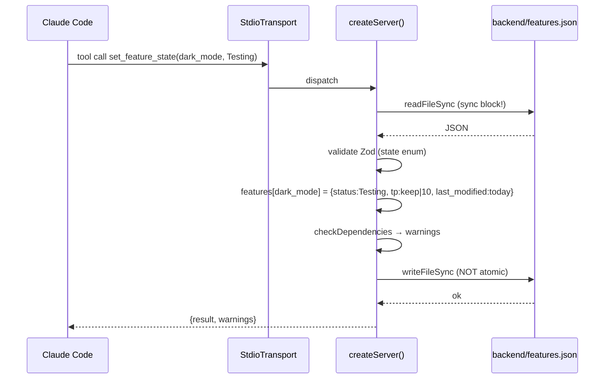
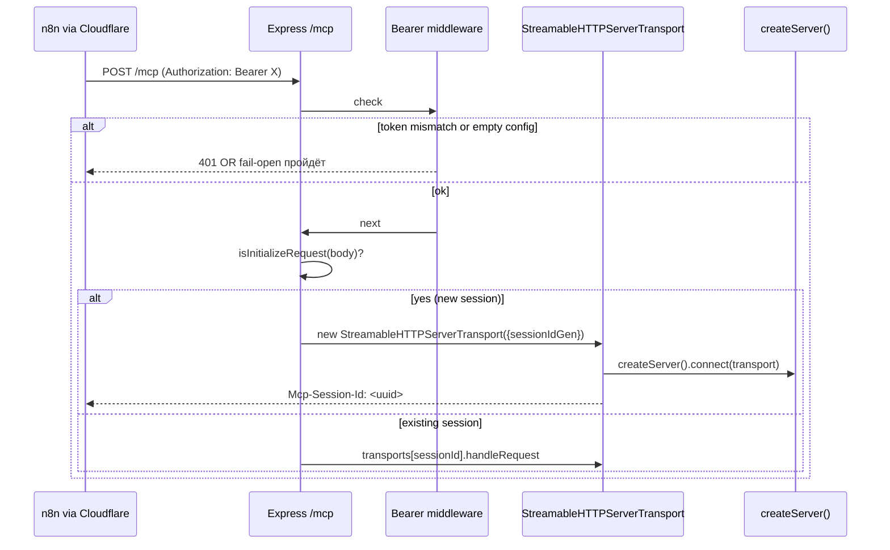

# Spec — mcp-features

**Модуль:** `mcp-features/index.js` (single-file MCP-сервер, dual transport).
**Хранилище:** `backend/features.json` (shared mutable JSON).
**Транспорты:** stdio (local Claude Code/Cursor) + StreamableHTTP (Docker, Cloudflare tunnel → n8n).
**ADR:** adr-007 (feature flag storage and ownership).

---

## 1. UNDERSTAND

MCP-сервер `proshop-feature-flags` экспонирует 4 tools и 1 resource поверх `backend/features.json`. Сервер запускается в одном из двух режимов в зависимости от `MCP_TRANSPORT` (или флагов `--http`/`--sse`):

- **stdio** — один процесс на сессию Claude Code / Cursor. `.mcp.json` спавнит. Без auth (доверенное окружение).
- **StreamableHTTP** — long-lived Express-сервер на порту `MCP_HTTP_PORT` (дефолт 7777). Bearer-token auth через `MCP_BEARER_TOKEN`. Используется в Docker Compose сервисе `mcp-features` для доступа из n8n через эфемерный Cloudflare-туннель.

Оба режима используют **общий `createServer()`** и одно и то же `features.json`. Tools:

1. **`get_feature_info(feature_id)`** — read одной фичи + map `dependencies_status`. Source: `readFeatures()` → JSON.parse файла.
2. **`set_feature_state(feature_id, state)`** — меняет `status`; авто-настройка `traffic_percentage` (Disabled→0, Enabled→100, Testing→keep 1..99 либо 10). Обновляет `last_modified` (YYYY-MM-DD). Прогоняет `checkDependencies` — возвращает warnings, не блокирует.
3. **`adjust_traffic_rollout(feature_id, percentage)`** — только для `status==='Testing'`. Целое 0..100. Дает hint при 0/100.
4. **`list_features()`** — полный каталог. Read-only, prefer over raw file grep.
5. **Resource `feature-flags`** (`file:///features.json`) — summary-список для discovery.

**Write-флоу** через `writeFeatures()`: `writeFileSync` напрямую (НЕ atomic — нет tmp+rename здесь, в отличие от `backend/routes/featureFlagRoutes.js`). Это конфликт с ADR-007 «single owner» — три процесса (Express, MCP-stdio, MCP-HTTP) пишут разными способами в один файл. Stage1 cluster A.

**Атомарность чтения:** `readFileSync` синхронный — блокирует event loop MCP-сервера. Stage1 PERF.

---

## 2. DECISION TABLE

### get_feature_info

| Condition | Then | Else | Edge |
|---|---|---|---|
| `readFeatures()` ENOENT | `isError:true` FILE_READ_ERROR | продолжаем | features.json удалён — MCP не падает, отдаёт structured error |
| JSON parse fail | `isError:true` JSON_PARSE_ERROR | — | concurrent write оставил file in half-written state → parse fail |
| feature_id отсутствует в `features` | `isError:true` FEATURE_NOT_FOUND + list available IDs | вернуть feature | feature_id с prototype-keys (`__proto__`) — Zod не валидирует regex; lookup `features[feature_id]` вернёт Object.prototype |

### set_feature_state

| Condition | Then | Else | Edge |
|---|---|---|---|
| state==='Disabled' | tp=0 | — | tp перезаписывается даже если был 50 |
| state==='Enabled' | tp=100 | — | — |
| state==='Testing' & tp∈[1,99] | keep tp | tp=10 | undefined/null/string tp → reset to 10 |
| dependencies missing or non-Enabled | result.warnings = [...] | — | НЕ блокирует — преднамеренно, по ADR-007 |
| `writeFeatures` IO fail | `isError:true` FILE_WRITE_ERROR | — | disk full → state в памяти изменён, но не сохранён → следующий read вернёт старое |

### adjust_traffic_rollout

| Condition | Then | Else | Edge |
|---|---|---|---|
| status !== 'Testing' | WRONG_STATUS_FOR_ROLLOUT | продолжаем | принуждает пользователя сначала вызвать set_feature_state |
| percentage не integer 0..100 | Zod schema reject | принять | float `50.5` — Zod schema `int()` reject |
| percentage===0 | hint: «consider Disabled» | — | подсказка, не действие |
| percentage===100 | hint: «consider Enabled» | — | — |

### HTTP transport auth

| Condition | Then | Else | Edge |
|---|---|---|---|
| `MCP_BEARER_TOKEN` empty | пропустить (fail-open) | проверять Bearer | **Stage1 SEC HIGH: пустой токен = публичный доступ** (Cluster A) |
| header `Authorization === Bearer ${token}` | next() | 401 | **`===` сравнение — timing attack** (Stage1 SEC MED) — должен `crypto.timingSafeEqual` |

---

## 3. SEQUENCE DIAGRAM

### stdio mode — set_feature_state

### HTTP mode — initialization + auth

---

## 4. EDGE CASES

- **Concurrent write от трёх процессов (Express, stdio, http).** Все используют разные стратегии: Express atomic (tmp+rename), MCP — direct overwrite. Если MCP пишет в момент чтения Express → Express может прочитать half-written JSON → `JSON.parse` throw → 500 (cluster A Stage1; ADR-007 говорит «shared store module» — не реализовано в коде).
- **`features[feature_id]` prototype pollution.** `feature_id = "__proto__"` — Zod не проверяет regex. `features.__proto__` существует на любом объекте, вернёт `Object.prototype`. `feature.status` будет undefined → лог «Feature not found»? Нет — falsy check проходит, но `feature.dependencies` тоже undefined → `[]` через `(feature.dependencies||[])`. Не пишет в файл (без феичи), но дёшево пробить. **Stage1 SEC**.
- **`writeFileSync` без atomic.** Crash/kill процесса в момент записи → corrupt JSON → следующий `readFeatures` throw → все три процесса в read-error. Recovery: ручное восстановление.
- **HTTP session lifetime.** `transports[sessionId]` живёт пока процесс жив + `transport.onclose` чистит. Утечка: если клиент рвёт соединение без close — entry остаётся? `onclose` зависит от транспорта. Memory-leak risk.
- **Cohere/Qdrant нет.** MCP-features не зависит от внешних API — full offline.
- **Cold start.** Каждая stdio-сессия — отдельный node-процесс, читает файл при первом tool call. HTTP — лениво при первом запросе, потом sessions переиспользуются.
- **last_modified только дата (YYYY-MM-DD).** Two flips в один день — одинаковый `last_modified` → drift detector «нет изменений». Stage1 ARCH-?? — not flagged Stage1 но реальный edge.
- **`checkDependencies` warning не блокирует.** AI-агент видит warning, может проигнорировать. Преднамеренно: «recommendation, not authority» (ADR-007).
- **Stdio transport — без shutdown gracefully.** Claude Code kill процесс → файл может остаться в нечитаемом состоянии если был mid-write.

---

## 5. Open Questions

- **ADR-007 compliance** (ARCH-DELTA-01): MCP должен PATCH через REST вместо direct writeFileSync. Когда лендим? Зависит от extraction `utils/featureFlag.js` API.
- **`MCP_BEARER_TOKEN` fail-open**: должен ли HTTP режим вообще запускаться без токена? Текущий: тихо пропускает auth. Предпочтение — fail-closed (refuse to start). Это ADR-008 open issue.
- **`set_feature_state` warnings — должны блокировать?** Сейчас warnings не блокируют (намеренно). AI-агент может игнорировать и активировать фичу без dependencies. Нужен strict mode?
- **`adjust_traffic_rollout` only for Testing** — ОК для UX, но если AI-агент хочет «set to Disabled and reduce traffic to 0» — должен сначала set_feature_state, потом adjust. Двойной round-trip. Стоит ли разрешить direct?
- **Atomic write в MCP** — нужно ли tmp+rename как в Express PATCH? Сейчас гонка возможна между MCP и Express.
- **Session ID prototype-key**: `transports[sessionId]` — SEC LOW. Стоит ли использовать `Map` вместо object literal?
- **stdio vs HTTP — должны ли быть отдельные binaries?** ADR-008 драфт обсуждает trade-off.
- **`feature_id` regex в Zod** — сейчас просто `z.string()`. Backend route валидирует regex; MCP — нет. Drift.

## 6. Suggested Characterization Tests

| # | Scenario | Assertion |
|---|---|---|
| MF1 | `get_feature_info('dark_mode')` | response contains status, traffic_percentage, dependencies_status |
| MF2 | `get_feature_info('nonexistent')` | isError: true, error.error === 'FEATURE_NOT_FOUND', list available IDs |
| MF3 | `get_feature_info('__proto__')` | edge case: prototype lookup — должен вернуть FEATURE_NOT_FOUND или ошибку |
| MF4 | `set_feature_state('dark_mode', 'Enabled')` | feature.status === 'Enabled', traffic_percentage === 100, last_modified === today |
| MF5 | `set_feature_state('dark_mode', 'Disabled')` | traffic_percentage === 0 |
| MF6 | `set_feature_state('x', 'Testing')` с текущим tp=50 | tp остаётся 50 |
| MF7 | `set_feature_state('x', 'Testing')` с tp=undefined | tp = 10 fallback |
| MF8 | `set_feature_state('x', 'Enabled')` где dep='y' имеет status='Disabled' | warnings содержит сообщение про y; state всё равно меняется |
| MF9 | `adjust_traffic_rollout('x', 50)` где status='Testing' | tp=50, status неизменен |
| MF10 | `adjust_traffic_rollout('x', 50)` где status='Enabled' | isError WRONG_STATUS_FOR_ROLLOUT |
| MF11 | `adjust_traffic_rollout('x', 50.5)` | Zod schema reject (int() rule) |
| MF12 | `adjust_traffic_rollout('x', 0)` | hint: «consider Disabled» |
| MF13 | `adjust_traffic_rollout('x', 100)` | hint: «consider Enabled» |
| MF14 | `list_features()` | возвращает массив со всеми feature_id |
| MF15 | HTTP mode с `MCP_BEARER_TOKEN` пустым | request без Authorization → 200 (fail-open!) — характеризует баг |
| MF16 | HTTP mode с `MCP_BEARER_TOKEN=secret` + correct Bearer | 200 |
| MF17 | HTTP mode с wrong Bearer | 401 |
| MF18 | HTTP mode init request (no session-id) | StreamableHTTP создаёт новый session, возвращает Mcp-Session-Id |
| MF19 | HTTP mode с stale session-id | 400 «Invalid or missing session ID» |
| MF20 | features.json corrupted JSON | isError FILE_READ_ERROR / JSON_PARSE_ERROR |
| MF21 | features.json missing (ENOENT) | isError FILE_READ_ERROR |

Implementation hint: расширить `homework/M6/stage2-fix-top3/tests/test-feature-flag-store.js`. HTTP transport тесты — supertest на mounted Express app (extracted из `runHttp()`).

## Cross-refs

- ADR-007 (feature-flag storage and ownership).
- Proposed ADR-008 (`proposed-adrs/adr-008-mcp-features-dual-transport.md`).
- `feature-flags-spec.md` (authoritative format).
- Stage1 cluster A, SEC HTTP-token findings.
- Stage2 fix-1 (`fix-1-feature-flag-store.md`) — частично смягчает: Express-сторона теперь делает atomic tmp+rename, но MCP всё ещё direct writeFileSync.
- Tests: `homework/M6/stage2-fix-top3/tests/test-feature-flag-store.js`.
