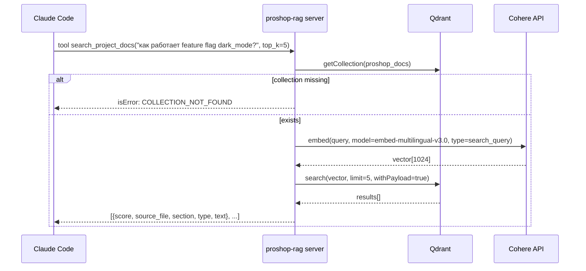
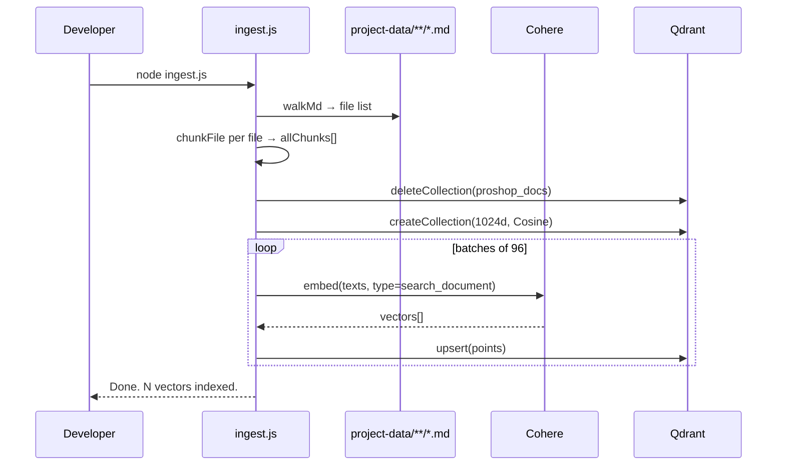

# Spec — mcp-rag

**Модуль:** `mcp-rag/index.js` (search server) + `mcp-rag/ingest.js` (one-shot ingestion).
**Зависимости:** Qdrant 1.14 (vector DB), Cohere embed-multilingual-v3.0 (1024-d).
**Транспорт:** stdio only.
**Источник данных:** `project-data/**/*.md`.

---

## 1. UNDERSTAND

RAG-сервер `proshop-rag` отдаёт два contract'а:

- **Tool `search_project_docs(query, top_k=5)`** — семантический поиск. Embed query через Cohere `embed-multilingual-v3.0` (input_type=`search_query`), поиск в Qdrant collection `proshop_docs` cosine-similarity, возврат top-k chunks {score, source_file, section, type, text}. Поддерживает русский/английский за счёт multilingual модели.
- **Resource `proshop-docs-index`** — сводный список проиндексированных файлов: scroll коллекции с payload `source_file/type/last_modified`, дедуп по `source_file`, sort lexical. Пагинация через `next_page_offset` пока не null.

`ingest.js` — отдельный скрипт. Workflow:

1. `walkMd(project-data)` — рекурсивный обход, фильтр `.md`.
2. `inferType(path)` — категоризация: `/runbooks/→runbook`, `/incidents/→incident`, `/adrs/→adr`, `/features/→feature`, `/api/→api`, `/pages/→page`, default `doc`.
3. `chunkFile(content)` — split по `\n## ` секциям. Если section ≤ 512 tokens — chunk целиком. Иначе split по параграфам (`\n\n+`), накопление в `current` пока не превысит `targetTokens=400`. Hard truncate single paragraph при > maxTokens\*4 chars. Min chunk = 25 tokens.
4. `extractSection(text)` — первый `## heading` или `(intro)`.
5. Cohere embed `inputType: 'search_document'`, batch 96, 1024-dim float vectors.
6. Qdrant `deleteCollection → createCollection` (idempotent — каждый запуск пересоздаёт), `upsert` points с payload {source_file, section, type, last_modified, text}.

Утилитарные режимы: `--test` (smoke chunker), `--dump [path]` (JSONL dump без Cohere/Qdrant).

---

## 2. DECISION TABLE

### search_project_docs

| Condition | Then | Else | Edge |
|---|---|---|---|
| `qdrant.getCollection(COLLECTION)` throw | isError:true COLLECTION_NOT_FOUND | продолжаем | Qdrant down vs collection missing — одинаковая ошибка (нет дифференциации) |
| Cohere embed throw | isError:true EMBED_FAILED + hint про API_KEY | вектор готов | API rate-limit vs auth — generic message |
| Qdrant search throw | isError:true SEARCH_FAILED | вернуть chunks | network blip → timeout, no retry |
| top_k > 15 | Zod schema reject | продолжаем | Zod `.max(15)` зашит |

### chunkFile (ingest)

| Condition | Then | Else | Edge |
|---|---|---|---|
| section ≤ maxTokens (512) | push целиком | split на параграфы | tiny section (< minTokens=25) — DROP |
| section > maxTokens | накопить параграфы в `current`, flush при > targetTokens | продолжаем | single paragraph > maxTokens\*4 chars → hard truncate с `' [truncated]'` |
| `current.trim()` после loop | flush | drop | last fragment < minTokens → DROP |

### ingest main

| Condition | Then | Else | Edge |
|---|---|---|---|
| COHERE_API_KEY missing | exit 1 | продолжать | проверка в обоих файлах (index + ingest) |
| `deleteCollection` throw | swallow («first run») | продолжаем | если Qdrant down → создание тоже фейлится → script throw |
| Cohere returned ≠ batch.length embeddings | throw | upsert | partial response — fail fast |
| `--test` flag | log counts + sample chunk, exit normal | продолжаем | НЕ запускает main() |
| `--dump` flag | JSONL dump, exit 0 | продолжаем | путь через `--dump <path>` либо default `chunks.jsonl` |

### proshop-docs-index (resource)

| Condition | Then | Else | Edge |
|---|---|---|---|
| `qdrant.scroll` throw | вернуть error JSON в resource | dedupe & sort | collection empty — пустой массив (не error) |
| `next_page_offset` null | end loop | continue | scroll лимит 100 — для большого индекса много round-trips (Stage1 PERF) |

---

## 3. SEQUENCE DIAGRAM

### search_project_docs happy path

### ingest pipeline

---

## 4. EDGE CASES

- **Idempotency cost.** Каждый ingest пересоздаёт коллекцию (`deleteCollection` + `createCollection`). Если ingest падает посреди upsert — коллекция остаётся пустой/частичной. Нет точечного reindex одного файла.
- **In-memory load.** `buildChunks()` грузит ВСЕ chunks в массив до первого embed. Для проекта ~10k lines docs это ОК (несколько MB), но для большого корпуса OOM (Stage1 PERF).
- **Cohere rate limit / cost.** Каждый search = round-trip к Cohere. Нет LRU кеша на одинаковые queries (Stage1 PERF).
- **`proshop-docs-index` scroll cost.** При каждом resource read — полный обход коллекции batches=100. Для 200+ файлов несколько round-trips. Stage1 PERF — рекомендован кеш на process lifetime.
- **Chunker drops короткие секции (< 25 tokens).** Например, ADR с 1-параграф summary полностью теряется. Edge: TODO-маркер «(intro)» секция без `##` heading из docs-audit могла быть < 25 tokens → drop.
- **Long single paragraph.** `[truncated]` суффикс — search вернёт фрагмент, информация теряется. Embedding всё же computed на truncated text → результат поиска ниже по релевантности.
- **Section header extraction.** `extractSection` ищет первый `## ` — если chunk начинается с параграфа (split-by-paragraph), будет `(intro)`. Множество chunks с одинаковым `(intro)` section name — навигация по результатам поиска путается.
- **Query injection (МНОГ).** `query` — текст для embed, не SQL/regex/code. Невозможно инъекцировать через семантический поиск; Cohere принимает любой text. Безопасный поверхностно.
- **Cohere API key в .env.** Тоже самое для COHERE_API_KEY — оба файла читают через dotenv. Если `.env` не найден — `process.env.COHERE_API_KEY` undefined → `process.exit(1)`.
- **Qdrant URL без auth.** Дефолт `http://localhost:6333` без API key. Если кто-то открыл порт наружу — collection доступна на чтение/запись из локальной сети (Stage1 SEC — потенциальная находка).
- **Кросс-файловые ссылки в docs.** Чанкер разрезает по `## `, ссылки `[link](path.md)` остаются в chunk text. Search вернёт chunk с link — Claude увидит, но MCP не resolve linked file (нет crawl).
- **`features.json` НЕ индексируется.** `walkMd` ищет только `.md` в `project-data/`. Feature flags только косвенно через `feature-flags-spec.md`. Если новая фича не описана в md — RAG её не знает.

---

## 5. Open Questions

- **Idempotency cost.** Полный delete+recreate коллекции на каждый ingest — write amplification + Cohere $ на каждый запуск даже для 1-file edit. Incremental reindex (по mtime)?
- **Query length cap.** SEC-MED — нет ограничения на длину query. Cohere принимает, но платно. Чейнджать Zod `.max(N)`?
- **`Math.round(r.score * 100) / 100`** — округление до 2 знаков для UX. Score 0.5 vs 0.5001 — drop precision. Намеренно?
- **`proshop-docs-index` resource cache.** Каждый read = full scroll. Stage3 PERF-D5. Process-lifetime cache?
- **Cohere model swap.** `embed-multilingual-v3.0` — 1024d. Если меняем на v4 (когда выйдет) — `VECTOR_SIZE` в ingest + collection нужно перепересоздать. Dim mismatch в `index.js` (отдельный файл) — silent при mismatch. ARCH-DELTA-08.
- **Symlinks в project-data.** `walkMd` использует `readdirSync` без `followSymbolicLinks` — текущий поведение Node 22 default? Если symlink на large file → бесконечный цикл?
- **Cohere/Qdrant credentials в .env.** Что делать если оба сервера запускаются одновременно с одинаковой проблемой? `process.exit(1)` — но `index.js` MCP сервер? Claude Code увидит broken server start.
- **`(intro)` section name.** Множество chunks с `(intro)` — search results теряют section navigation. Использовать filename как fallback?

## 6. Suggested Characterization Tests

| # | Scenario | Assertion |
|---|---|---|
| R1 | `buildChunks()` на текущей project-data | возвращает массив > 50 chunks, каждый имеет source_file/section/type/text/last_modified |
| R2 | `chunkFile` на 1 секции < 25 tokens | пустой массив (drop) |
| R3 | `chunkFile` на 1 секции 100-512 tokens | один chunk, целиком |
| R4 | `chunkFile` на 1 секции 1500 tokens с 3 параграфами | split на 2-3 chunks по targetTokens |
| R5 | `chunkFile` на 1 параграфе 3000 tokens (single mega-para) | hard truncate с `' [truncated]'` суффиксом |
| R6 | `inferType('project-data/adrs/adr-001.md')` | 'adr' |
| R7 | `inferType('project-data/runbooks/x.md')` | 'runbook' |
| R8 | `inferType('project-data/architecture.md')` | 'doc' (default) |
| R9 | `extractSection` с `## Heading\nbody` | '## Heading' |
| R10 | `extractSection` с `body without heading` | '(intro)' |
| R11 | ingest полный прогон smoke (mock Cohere + Qdrant) | logs «Done. N vectors indexed» |
| R12 | `search_project_docs` когда collection отсутствует | isError COLLECTION_NOT_FOUND |
| R13 | `search_project_docs` Cohere fail | isError EMBED_FAILED |
| R14 | `search_project_docs` Qdrant search fail | isError SEARCH_FAILED |
| R15 | `search_project_docs` happy path | chunks[].score округлены до 2 знаков |
| R16 | `top_k=16` | Zod schema reject (max 15) |
| R17 | `top_k=0` | Zod reject (min 1) |
| R18 | `proshop-docs-index` resource read | возвращает unique source_file list, sorted |
| R19 | `--test` flag | logs count + sample, exit 0 |
| R20 | `--dump custom.jsonl` | пишет JSONL с N lines, exit 0 |

Implementation hint: тесты для `buildChunks`/`chunkFile`/`inferType`/`extractSection` — unit, без Cohere/Qdrant. Полный ingest — mock через jest.mock cohere-ai + @qdrant/js-client-rest.

## Cross-refs

- `mcp-rag-project-data.md` (design spec).
- `mcp-design-principles.md` (общие принципы MCP-серверов).
- Stage1 PERF mcp-rag findings.
- Зависимость от `project-data/` структуры — изменения в layout сломают inferType.
- Reindex после изменений: `cd mcp-rag && node ingest.js`.
