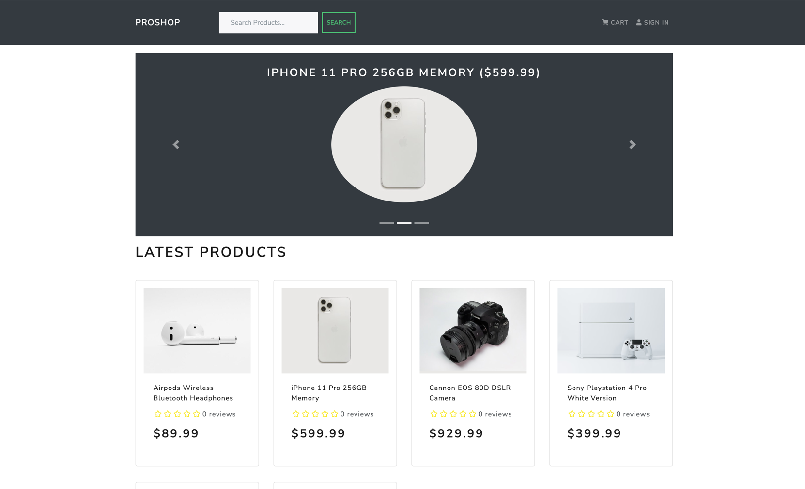

# M2 - Report

## IDE

- Primary: Claude code

## Rules diff

- Added `Key Patterns`, however I haven't worked yet with this stack, so I totally relied on Claude code recommendation. 
- Controller comments
- Async error handling
- Redux action shape
- Adding npm install
- Secrets & Env Safety

### Start project

I was able to run project on my local machine.

### Fixing issues

https://github.com/galillei/proshop_mern/commit/c48abc247434f8b1ea79e73d54b5130454f07cea
https://github.com/galillei/proshop_mern/commit/c48abc247434f8b1ea79e73d54b5130454f07cea

